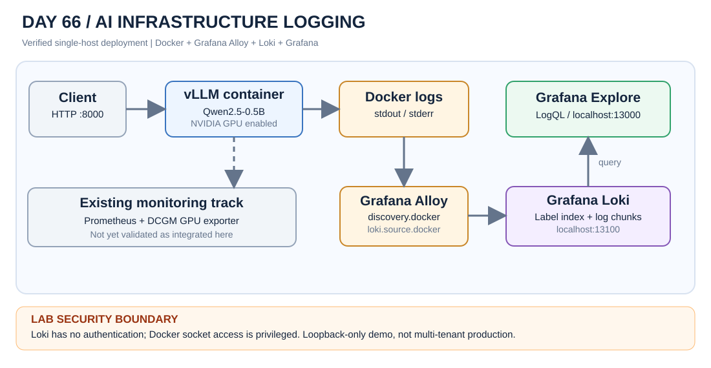
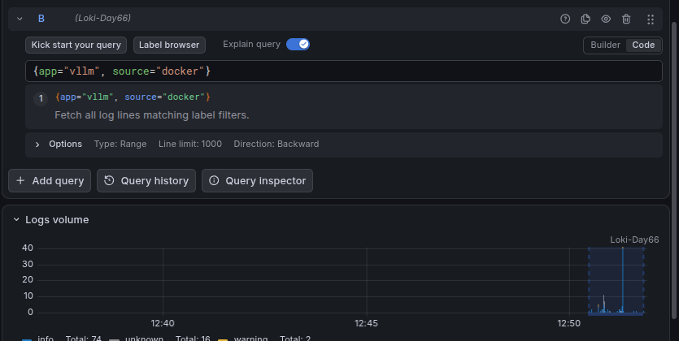
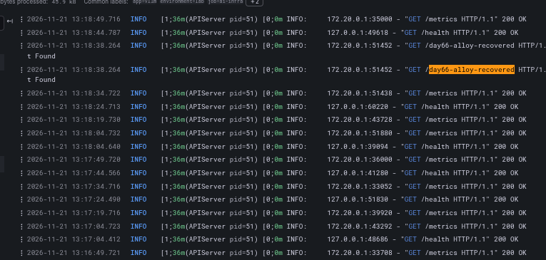

# Day 66: GPU Inference + Centralized Logging (Docker, Alloy, Loki, Grafana)

> **Evidence-backed AI Infrastructure learning project | 21 November 2026 | Day 66/220**  
> **Status:** Tested locally on an NVIDIA RTX 3070 Laptop GPU (8 GiB). This is a **single-host development lab**, not a hardened production deployment.

## Why this project matters

Centralized logs let an infrastructure engineer diagnose an inference incident without checking each container manually. This lab demonstrates how a GPU-backed, OpenAI-compatible vLLM service emits stdout/stderr, how Grafana Alloy discovers its Docker container and forwards entries to Loki, and how Grafana's LogQL queries reveal request and service behavior. It extends earlier Prometheus, Grafana, and DCGM exercises, but **does not claim their metrics are wired into this new Grafana instance**.



## Verified outcomes (observed, not fabricated)

| Check | Evidence from the lab | Assessment |
| --- | --- | --- |
| Docker GPU access | `nvidia-smi` succeeded inside a vLLM image | Pass |
| Inference service | `day66-vllm` became `healthy`; `/health` worked | Pass |
| Chat endpoint | Chat completion from `Qwen/Qwen2.5-0.5B-Instruct` | Pass |
| Native container logs | Docker stdout/stderr showed vLLM startup and access entries | Pass |
| Centralized logs | `{app="vllm", source="docker"}` returned real container logs | Pass |
| HTTP 404 investigation | `day66-intentional-404` visible as `INFO` access log | Pass |
| Collector outage | vLLM remained healthy during stopped Alloy | Pass |
| Local log retention | Docker still had `day66-alloy-outage-test` entry | Pass |
| Collector recovery | Both outage-test and recovery-test entries visible after restart | Pass |

**What this evidence does not establish:** sustained inference throughput, p95 SLO compliance, high availability, zero data loss across all collector failures, a production Kubernetes cluster, or secure multi-tenant logging. The screenshot after restarting Alloy proves backfill for this outage **only**; it does not independently show the result of a Loki query while Alloy was stopped.

### Observed deployment configuration

- **Host:** NVIDIA RTX 3070 Laptop GPU, 8 GiB; NVIDIA driver `580.196.07` reported in user output.
- **Serving image:** `vllm/vllm-openai:v0.11.0` (the earlier native vLLM environment had version `0.33.0`; **do not compare versions' performance as if equal**).
- **Model:** `Qwen/Qwen2.5-0.5B-Instruct`; `float16`; `max-model-len=2048`; `gpu-memory-utilization=0.65`.
- **Collector/store/UI:** Alloy `v1.22.0`, Loki `3.7.10`, Grafana `13.3.0`.
- **Observed startup values (not a load benchmark):** model weights ~0.927 GiB, available KV cache memory ~3.47 GiB, engine initialization ~25.03 s. Reported `148.11x` theoretical concurrency is an allocation/capacity estimate, *not measured request concurrency*.

## Architecture and key files

| Path | Purpose |
| --- | --- |
| `compose.yaml` | Loki, Alloy and Grafana local services |
| `compose.vllm.yaml` | GPU-backed vLLM and Docker-aware Alloy Compose overlay |
| `config.alloy` | Initial **file-based** collector (baseline lesson) |
| `config.docker.alloy` | Docker discovery + `loki.source.docker` + demo file source |
| `loki-config.yaml` | Single-binary Loki with local filesystem storage |
| `provisioning/datasources/loki.yaml` | Grafana Loki data source |
| `docs/architecture.svg` | Architecture diagram for GitHub |
| `docs/ARCHITECTURE.md` | Data-flow, labels, trust boundary, failure modes |
| `docs/Day66_Centralized_Logging_Notes.pdf` | Illustrated course/reference notes |
| `docs/Day66_Centralized_Logging_Notes.tex` | Editable LaTeX source for the notes |
| `scripts/smoke-test.sh` | Health / API / LogQL smoke tests |

## Reproduce the deployment

### 0. Prerequisites

Ubuntu/Linux with Docker Compose, an NVIDIA GPU and NVIDIA Container Toolkit configured for GPU containers; network access to download the model and images. Check available GPU RAM and disk space. The example is sized for a single 8 GiB GPU.

### 1. Configure the local-only stack

```bash
cd Day66_Portfolio_Centralized_Logging
umask 077
printf 'GRAFANA_ADMIN_PASSWORD=%s\n' \
  "$(python3 -c 'import secrets; print(secrets.token_urlsafe(24))')" > .env
mkdir -p logs
touch logs/lab.log logs/vllm.log
# Protect the local credential and avoid committing it.
docker compose -f compose.yaml -f compose.vllm.yaml config --quiet
```

`compose.vllm.yaml` is an overlay. **Always include both files** when operating the complete stack. `.env` contains a secret; never commit it. The provided `.gitignore` excludes `.env` and lab log files.

### 2. Test GPU access, then launch

```bash
docker compose -f compose.yaml -f compose.vllm.yaml pull
docker compose -f compose.yaml -f compose.vllm.yaml \
  run --rm --no-deps --entrypoint nvidia-smi vllm
# Stop any prior host vLLM service that owns port 8000, only after verifying it.
docker compose -f compose.yaml -f compose.vllm.yaml up -d
docker compose -f compose.yaml -f compose.vllm.yaml ps
```

Keep an eye on model startup, which may take longer on the first launch:

```bash
docker logs --tail=60 day66-vllm
curl -fsS http://127.0.0.1:13100/ready
curl -fsS http://127.0.0.1:8000/health
```

A temporary HTTP 503 from `/ready` during Loki initialization is not automatically a failed deployment; repeat after checking its logs.

### 3. Send a genuine inference request

```bash
curl -fsS http://127.0.0.1:8000/v1/chat/completions \
  -H 'Content-Type: application/json' \
  -d '{"model":"Qwen/Qwen2.5-0.5B-Instruct", "messages":[{"role":"user","content":"Reply with OK."}], "max_tokens":16,"temperature":0}' \
  | python3 -m json.tool
```

A response truncated with `finish_reason: "length"` means the output hit the requested token limit; it does **not** prove that model serving failed.

### 4. Query real container logs

Open Grafana at [http://127.0.0.1:13000](http://127.0.0.1:13000) and select **Explore → Loki-Day66**:

```logql
{app="vllm", source="docker"}
```

Or use the Loki HTTP API:

```bash
curl -fsSG 'http://127.0.0.1:13100/loki/api/v1/query_range' \
  --data-urlencode 'query={app="vllm",source="docker"}' \
  --data-urlencode 'since=1h' | python3 -m json.tool
```

The initial demonstration still works as `{app="day66-demo"}`, where the synthetic `logs/lab.log` file is collected separately. **Do not confuse it with real server-side logs.**

## Controlled incidents (reproducible)

### Incident A — HTTP 404, while server is healthy

```bash
curl -sS -o /dev/null -w 'status=%{http_code}\n' \
  http://127.0.0.1:8000/day66-intentional-404
```

Find the access log with:

```logql
{app="vllm",source="docker"} |= "day66-intentional-404"
```

It was observed as an `INFO` access log with HTTP 404. **Log severity is not HTTP response status.**

### Incident B — Alloy collector outage and recovery

In a controlled local lab only:

```bash
docker stop day66-loki-alloy-1
curl -sS -o /dev/null -w 'status=%{http_code}\n' \
  http://127.0.0.1:8000/day66-alloy-outage-test
docker logs --since 2m day66-vllm 2>&1 | grep day66-alloy-outage-test
docker start day66-loki-alloy-1
curl -sS -o /dev/null -w 'status=%{http_code}\n' \
  http://127.0.0.1:8000/day66-alloy-recovered
```

Then query separately:

```logql
{app="vllm",source="docker"} |= "day66-alloy-outage-test"
{app="vllm",source="docker"} |= "day66-alloy-recovered"
```

In the completed lab, **both** entries appeared after restarting Alloy. This demonstrates backfill in that test, **not** zero-loss guarantees for arbitrary outages. The collector's saved read positions and Docker log retention affect recovery.

## Useful LogQL examples

```logql
{app="vllm",source="docker"}
{app="vllm",source="docker"} |= "404"
{app="vllm",source="docker"} |~ "ERROR|WARNING"
sum(count_over_time({app="vllm",source="docker"} |= "day66-intentional-404" [5m]))
sum(rate({app="vllm",source="docker"} |= "ERROR" [5m]))
{app="day66-demo"} | json | latency_ms > 200
```

`count_over_time` counts *matching log lines* and `rate` estimates matching lines/second. Neither necessarily measures unique failed HTTP requests. Current vLLM logs are mostly **plain-text**, so don't assume `| json` works on those lines. JSON parsing in this project is demonstrated by the separate demo log source.

## Validation / diagnostics

```bash
bash scripts/smoke-test.sh
# If Loki has no matches:
docker compose -f compose.yaml -f compose.vllm.yaml logs --tail=100 alloy
docker compose -f compose.yaml -f compose.vllm.yaml logs --tail=100 loki
docker logs --tail=100 day66-vllm
```

Inspect labels, time windows, container discoverability and the Docker socket mount. Distinguish `status=success` **with no results** from a failed HTTP query. Grafana's last-15-minutes range can hide older entries even when data is present.

## Security / limitations

**Local lab, not production:** Services are bound to host loopback (`127.0.0.1`). Loki uses `auth_enabled: false`; no authentication, tenant isolation or TLS is configured. The Docker socket mounted in Alloy grants broad access to the Docker daemon **even when mounted `:ro`**; a production collector should use a better-isolated mechanism, such as an access-controlled proxy or appropriate Kubernetes-native log collection. The HF cache is host-mounted, and container logs are rotated at 3 × 10 MB; outages longer than retained data can lose records. Avoid logging prompts, user content, secrets or tokens. Production designs need access control, encryption, retention, collection monitoring, and documented recovery limits.

## Next steps (not yet verified)

1. Connect or provision a **unified** Grafana view of Loki logs, Prometheus inference metrics and DCGM GPU metrics. Existing older services run, but this integration has not been demonstrated here.
2. Implement log ingestion health alerts and Loki retention policies; explicitly test outages longer than Docker retention.
3. Add structured inference request metadata without collecting prompt content or indexing high-cardinality request IDs.
4. Migrate the container to Kubernetes with collector permissions scoped to the cluster design.
5. Standardize the vLLM version before measuring performance against previous native tests.

## References

- [Grafana Alloy Docker source](https://grafana.com/docs/alloy/latest/reference/components/loki/loki.source.docker/)
- [Grafana Loki label cardinality](https://grafana.com/docs/loki/latest/get-started/labels/cardinality/)
- [Grafana Alloy container monitoring](https://grafana.com/docs/alloy/latest/monitor/monitor-docker-containers/)
- [vLLM Docker serving](https://docs.vllm.ai/en/latest/deployment/docker/)
- [LogQL overview](https://grafana.com/docs/loki/latest/query/)

## Ownership and publication

All configs are example artifacts derived from a tested local learning session. Review them before publishing or running outside your machine. Commit/push to GitHub **manually** after checking for secrets, private log content and any credentials.

## Screenshot evidence (verify before public sharing)





See [evidence notes](evidence/README.md) for limitations.
