# Day 35 — Kubernetes GPU Infrastructure Capstone

**Date:** October 17, 2026  
**Roadmap:** AI Infrastructure & ML Systems, Day 35/220 (GPU Infrastructure phase)  
**Environment:** Ubuntu 24.04 host, Minikube (`gpu-lab`, Docker driver), Kubernetes v1.35.1, NVIDIA GeForce RTX 3070 Laptop GPU (8 GiB)

## Overview

This capstone validates the path from a physical NVIDIA GPU through Kubernetes device-plugin discovery and GPU-aware scheduling to a working CUDA/PyTorch application. It includes two reproduced operational incidents and a GPU-contention exercise.

**Verified outcomes**

- Restored a GPU device-plugin DaemonSet with `DESIRED=0` by correcting a taint/toleration mismatch.
- Verified DaemonSet `DESIRED=1`, `READY=1`, and node resource `nvidia.com/gpu` **capacity=1, allocatable=1**.
- Ran a Kubernetes PyTorch Job with CUDA availability `True`, **one visible GPU**, and exit code **0**.
- Demonstrated that two Pods each asking for one GPU are executed sequentially when the node allocates only one GPU and no sharing is configured.
- Reproduced `FailedScheduling: Insufficient nvidia.com/gpu` with a two-GPU request, then corrected the request to one GPU and verified CUDA execution.

## Architecture

```mermaid
flowchart TD
    A[GPU Job / Pod manifest] --> B[Kubernetes scheduler]
    B --> C[GPU node: gpu-lab]
    D[NVIDIA Device Plugin DaemonSet] -->|registers nvidia.com/gpu| E[Kubelet]
    E --> C
    C --> F[Container runtime + NVIDIA GPU integration]
    F --> G[PyTorch CUDA application]
    G --> H[NVIDIA RTX 3070 Laptop GPU]
```



> The device plugin registers allocatable resources with kubelet; the scheduler allocates based on Kubernetes resource requests, not live GPU utilization. The diagram represents logical roles, not a strict call sequence.

## Environment observed

| Component | Observed value |
|---|---|
| Host GPU | NVIDIA GeForce RTX 3070 Laptop GPU, 8 GiB |
| Host driver | 580.178.04 (`nvidia-smi`) |
| CUDA version reported by `nvidia-smi` | 13.0 (driver-supported API level, not the PyTorch build) |
| Minikube version | v1.38.1 |
| Kubernetes node | `gpu-lab`, Kubernetes v1.35.1 |
| Container runtime reported by node | `docker://29.2.1` |
| NVIDIA device-plugin image | `nvcr.io/nvidia/k8s-device-plugin:v0.18.2` |
| PyTorch image | `pytorch/pytorch:2.5.1-cuda12.4-cudnn9-runtime` |
| PyTorch CUDA build | PyTorch 2.5.1+cu124; CUDA 12.4 |
| Workload namespace | `day35` |
| Node label | `accelerator=gpu` |
| Node taint | `dedicated=gpu:NoSchedule` |

## Labs and manifests

These are the actual manifest names used during the lab. Copy your working local manifests into this folder when publishing; **review before overwriting existing local files**.

| File | Purpose | Verified outcome |
|---|---|---|
| `gpu-pytorch-job.yaml` | One-GPU PyTorch matrix multiplication | Job succeeded; exit code 0 |
| `gpu-contention-job.yaml` | Two successful executions with parallelism 2 | One Pod ran while the other waited; both completed |
| `gpu-overrequest-broken.yaml` | Intentionally request 2 GPUs | Pending with `Insufficient nvidia.com/gpu` |
| `gpu-overrequest.yaml` | Correct the request to 1 GPU | Completed; CUDA available |

Reproduce only on a **dedicated lab cluster**. The device-plugin repair directly changes an addon-managed DaemonSet.

### Quick verification

```bash
nvidia-smi
kubectl config current-context
kubectl get nodes -o wide
kubectl -n kube-system get daemonsets
kubectl get nodes -o jsonpath='{range .items[*]}{.metadata.name}{"\t"}{.status.capacity.nvidia\.com/gpu}{"\t"}{.status.allocatable.nvidia\.com/gpu}{"\n"}{end}'
```

In the current lab setup, a healthy GPU registration yields `gpu-lab  1  1`.

### GPU workload

```bash
kubectl create namespace day35 --dry-run=client -o yaml | kubectl apply -f -
kubectl apply -f gpu-pytorch-job.yaml
kubectl get jobs,pods -n day35
kubectl logs -n day35 job/day35-pytorch-gpu
```

### GPU contention

```bash
kubectl apply -f gpu-contention-job.yaml
kubectl get pods -n day35 -l batch.kubernetes.io/job-name=day35-gpu-contention -w
kubectl describe node gpu-lab
```

Capture a Pending pod's **events** before it transitions to Running:

```bash
kubectl describe pod -n day35 <PENDING_POD_NAME>
```

### GPU over-request and correction

```bash
kubectl apply -f gpu-overrequest-broken.yaml
kubectl describe pod day35-gpu-overrequest -n day35
# Expected: FailedScheduling ... Insufficient nvidia.com/gpu
kubectl delete pod day35-gpu-overrequest -n day35
kubectl apply -f gpu-overrequest.yaml
kubectl get pod day35-gpu-overrequest -n day35
kubectl logs -n day35 pod/day35-gpu-overrequest
```

## Recorded PyTorch microbenchmark (single run)

| Measurement | Result |
|---|---:|
| Matrix shape | 3072 × 3072 |
| Warm-up iterations | 5 |
| Timed operations | 20 matrix multiplications |
| Aggregate elapsed time | 0.1268 s |
| Mean time per operation | 6.34 ms |
| Peak allocated GPU memory (PyTorch allocator) | 152.12 MiB |
| CUDA available | `True` |
| Visible GPU devices | 1 |
| Job exit code | 0 |

The code called `torch.cuda.synchronize()` after warm-up and after the timed operations. These are **observed single-run numbers**, not a sustained-throughput benchmark, a latency distribution, a full-device VRAM reading, or a multi-GPU result. Future iterations should include repeated runs, variance, image start-up timing, GPU utilization samples, and a documented workload shape.

## Incidents

1. **Device plugin not scheduled:** GPU node had taint `dedicated=gpu:NoSchedule`; plugin DaemonSet tolerated only `nvidia.com/gpu:NoSchedule`. Adding a matching `dedicated=gpu` toleration changed DaemonSet `DESIRED/READY` from `0/0` to `1/1` and restored `nvidia.com/gpu: 1` allocatable.
2. **GPU resource over-request:** Pod requesting 2 GPUs on a node exposing 1 was Pending; scheduler reported `Insufficient nvidia.com/gpu`. Recreating the pod with GPU limit 1 led to a completed CUDA test.

See [INCIDENTS.md](INCIDENTS.md) for reproducible symptoms, fixes, evidence, and operational takeaways; see [RUNBOOK.md](RUNBOOK.md) for a repeatable triage checklist.

## Known limitations / follow-ups

- Some successful CUDA runs printed `ERROR: driverInitFileInfo 578 result=11`, `ERROR: init 664 result=11`, and `ERROR: init 250 result=11` after the successful application message. **Origin and impact are not established**; track recurrence and correlate with pod/container exit status before changing drivers.
- The corrected standalone GPU Pod was listed as `BestEffort` QoS because it specified only an extended GPU resource, without CPU or memory requests/limits. GPU allocation still worked, but production jobs should define appropriate CPU and memory resources.
- An addon-managed DaemonSet can be reset by Minikube addon reconfiguration. Record/reapply intended tolerations through the proper deployment management path.
- This capstone uses **one** consumer laptop GPU; no MIG or actual multi-GPU performance claims are made. MIG is not supported on this RTX 3070 Laptop GPU.
- No direct scheduler `FailedScheduling` event was archived for the contention Job in the supplied log, although one pod's Pending-to-Running transition after the other's completion was observed.

## Portfolio takeaway

> Diagnosed an NVIDIA Device Plugin scheduling failure in a tainted Kubernetes GPU node, restored GPU registration, validated CUDA/PyTorch execution, and reproduced GPU scheduling contention and resource-overrequest recovery with observed metrics and event evidence.

## References

- [Kubernetes: Schedule GPUs](https://kubernetes.io/docs/tasks/manage-gpus/scheduling-gpus/)
- [Kubernetes: DaemonSets](https://kubernetes.io/docs/concepts/workloads/controllers/daemonset/)
- [Kubernetes: Pod QoS](https://kubernetes.io/docs/concepts/workloads/pods/pod-qos/)
