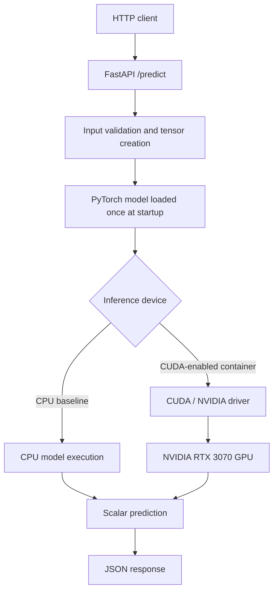

# Day 39 — GPU-Backed Inference with FastAPI, PyTorch, and Docker

> **AI Infrastructure & ML Systems — 220-Day Roadmap**  
> **Phase 3: Model Serving / Inference Infrastructure**  
> **Hardware:** NVIDIA GeForce RTX 3070 Laptop GPU  
> **Status:** GPU inference implemented, containerized, and benchmarked

## Overview

This lab extends the earlier FastAPI/PyTorch inference server (Days 37–38) to execute predictions on an NVIDIA GPU inside Docker. It validates GPU access from a container, explicitly places the model and input tensors on the selected device, and compares CPU and GPU inference performance at two levels:

1. **End-to-end HTTP performance:** latency and single-client throughput of the `/predict` endpoint.
2. **Local model execution:** CPU wall-clock timing, GPU wall-clock timing, and a CUDA-event measurement of a GPU execution region.

The central engineering lesson is that **GPU availability, GPU execution, and GPU performance are different things**. A correctly configured GPU-backed service is not automatically faster for every workload.

## Architecture



**GPU execution flow:** Docker exposes the host GPU through the NVIDIA Container Toolkit (`--gpus all`); a CUDA-enabled PyTorch build selects `cuda:0`; the model and input tensors are placed on that device. FastAPI returns a scalar prediction after the required computation completes.

## Environment verified in this lab

| Component | Observed value |
| --- | --- |
| GPU | NVIDIA GeForce RTX 3070 Laptop GPU |
| PyTorch in container | `2.14.1+cu130` |
| CUDA build reported by PyTorch | `13.0` |
| CUDA available inside container | `True` |
| GPUs visible inside container | `1` |
| CUDA operation output device | `cuda:0` |
| Container image used for serving | `ai-inference:gpu` |
| GPU serving port | `127.0.0.1:8002` |
| CPU serving port | `127.0.0.1:8003` |

The standalone GPU verification script reported **8.26 MiB** via `torch.cuda.memory_allocated(0)`. This is *PyTorch tensor memory allocated at the time of measurement*, **not** total GPU VRAM consumption or peak memory usage.

## Project layout

The serving application from Day 37 is reused rather than duplicated:

```text
ai-infra/
├── day37-fastapi-inference/
│   ├── main.py                  # FastAPI endpoints and lifespan device selection
│   ├── model.py                 # TinyRegressionModel
│   └── Dockerfile               # Inference container image
└── day39-gpu-inference/
    ├── README.md                # This document
    ├── gpu_inference.py         # Standalone GPU inference verification
    ├── benchmark_http.py       # HTTP CPU/GPU comparison
    └── benchmark_cuda.py       # Local CPU, GPU and CUDA-event timings
```

> This is the intended repository layout. Include the actual referenced scripts and the Day 37 serving application when publishing so the instructions are reproducible.

## Serving implementation

The FastAPI application loads the model **once per application worker** in its lifespan handler:

```python
require_cuda = os.getenv("REQUIRE_CUDA", "0") == "1"
if require_cuda and not torch.cuda.is_available():
    raise RuntimeError("GPU inference required, but CUDA is unavailable")

device = torch.device("cuda:0" if torch.cuda.is_available() else "cpu")
app.state.device = device
app.state.model = TinyRegressionModel().to(device)
app.state.model.eval()

# The lifespan async context manager must yield before shutdown cleanup.
yield

del app.state.model
```

Each prediction creates an input tensor on the same device as the model:

```python
features = torch.tensor([payload.features], dtype=torch.float32, device=device)
with torch.inference_mode():
    prediction = model(features)
prediction_value = round(float(prediction.item()), 6)
```

- `model.eval()` applies evaluation behavior to relevant layers; **it does not disable autograd**.
- `torch.inference_mode()` avoids autograd overhead during inference.
- `.item()` obtains the scalar output for JSON serialization and waits for any required GPU work.
- `REQUIRE_CUDA=1` means **fail startup if CUDA is unavailable**. It does **not** mean GPU index 1; the selected device is explicitly `cuda:0`.
- `/ready` verifies that a model was loaded; it is not, by itself, a continuous GPU-health check.

### API endpoints

| Endpoint | Method | Purpose |
| --- | --- | --- |
| `/health` | `GET` | Basic process health response |
| `/ready` | `GET` | Confirms the model is loaded |
| `/predict` | `POST` | Runs inference on the selected device |

Example request:

```bash
curl -s -X POST http://127.0.0.1:8002/predict \
  -H 'Content-Type: application/json' \
  -d '{"features": [1.0, 2.0, 3.0]}'
```

Observed response:

```json
{"prediction_value": 2.4, "model_version": "demo-linear-v1"}
```

## Reproduce the Docker experiment

### Prerequisites

- A Linux host with an NVIDIA GPU and a working NVIDIA driver (`nvidia-smi`).
- Docker Engine configured with NVIDIA Container Toolkit GPU support.
- A CUDA-enabled PyTorch installation in the existing inference image.
- The Day 37 FastAPI project (`main.py`, `model.py`, `Dockerfile`).
- Python with PyTorch available in the local environment for `benchmark_cuda.py`.

The exact compatible driver and container runtime setup depends on the host. Check device access rather than assuming the host and container use the same CUDA toolkit installation.

### 1. Build the application image

```bash
cd ~/ai-infra/day37-fastapi-inference
docker build -t ai-inference:gpu .
```

### 2. Start the GPU service

```bash
docker run -d \
  --name inference-gpu \
  --gpus all \
  -p 127.0.0.1:8002:8000 \
  -e REQUIRE_CUDA=1 \
  ai-inference:gpu

docker logs inference-gpu
```

Expected startup log includes `Inference device: cuda:0`.

### 3. Start the CPU baseline

```bash
docker run -d \
  --name inference-cpu \
  -p 127.0.0.1:8003:8000 \
  -e REQUIRE_CUDA=0 \
  ai-inference:gpu

docker logs inference-cpu
```

Expected startup log includes `Inference device: cpu`. The CPU container intentionally **omits `--gpus all`**. `REQUIRE_CUDA=0` permits CPU fallback but does not independently force CPU execution if a GPU is exposed by another configuration.

If Docker reports that a container name is already in use, inspect it with `docker ps -a` and decide whether to stop/remove or rename that specific container before reusing the name.

### 4. Confirm readiness and prediction

```bash
curl -s http://127.0.0.1:8002/ready
curl -s http://127.0.0.1:8003/ready

curl -s -X POST http://127.0.0.1:8002/predict \
  -H 'Content-Type: application/json' \
  -d '{"features": [1.0, 2.0, 3.0]}'
```

### 5. Benchmark HTTP performance

```bash
cd ~/ai-infra/day39-gpu-inference
python benchmark_http.py
```

The recorded script used **20 warmup requests** and **300 timed requests** per service, submitted sequentially from one client. Reported throughput is therefore **single-client completed request rate**, not a maximum server capacity measurement.

### 6. Benchmark local model execution

```bash
PYTHONPATH="$HOME/ai-infra/day37-fastapi-inference" \
  python benchmark_cuda.py
```

The recorded script used **100 warmup iterations** and **300 measurement iterations**. It compared CPU model execution plus scalar conversion, GPU execution plus transfers/scalar conversion, and CUDA-event timing around a GPU forward-pass region with input preloaded on the GPU.

## Measured results

### A. End-to-end HTTP benchmark

| Metric | CPU | GPU | Observed comparison |
| --- | ---: | ---: | --- |
| Timed requests | 300 | 300 | Sequential requests per service |
| p50 latency | **0.918 ms** | **0.784 ms** | GPU p50 **14.6% lower** |
| p95 latency | **1.458 ms** | **1.074 ms** | GPU p95 **26.3% lower** |
| Throughput | **951.85 req/s** | **1200.19 req/s** | GPU **26.1% higher** |

### B. Local inference benchmark

| Measurement | Median time |
| --- | ---: |
| CPU model execution + scalar conversion | **0.0216 ms** |
| GPU model execution + input transfer + scalar conversion | **0.0660 ms** |
| GPU execution region measured with CUDA events | **0.0569 ms** |

For this tiny model, the **CPU wall-clock execution path was approximately 3.06× faster** than the GPU wall-clock execution path in this local test.

### Interpretation

The apparent reversal between the HTTP benchmark and local inference benchmark is **not sufficient to conclude that the GPU accelerates this model in production**. These experiments measure different scopes, were not run as repeated alternating trials, and may be influenced by system scheduling, request overhead, CPU/GPU clocks, and measurement variability.

The CUDA-event result measures elapsed time between events recorded around a forward-pass region, not necessarily the isolated sum of CUDA kernel execution times. It should **not** be directly subtracted from the separately collected GPU wall-clock result to claim an exact data-transfer cost.

**What is supported by the data:**

- The container and the FastAPI endpoint successfully performed GPU-backed inference.
- In one sequential HTTP run, the GPU-backed service returned lower p50/p95 latency and higher completed requests/second.
- In one local microbenchmark, the CPU completed the tiny model's inference path faster than the GPU path.
- These measurements motivate more controlled benchmarking before choosing a production deployment configuration.

## Troubleshooting notes

| Symptom | Likely investigation |
| --- | --- |
| `torch.cuda.is_available()` is `False` in Docker | Check `--gpus all`, NVIDIA Container Toolkit integration, CUDA-enabled PyTorch build, and host driver compatibility. |
| Model on CUDA but input on CPU | Explicitly move input tensors to the model device; PyTorch generally raises a device mismatch error. |
| GPU-required service fails at startup | Check the `REQUIRE_CUDA=1` requirement and confirm that CUDA is available inside the container. |
| GPU memory exhaustion | Check model copies per worker, activations, concurrent requests, allocator reservations, and device memory usage. |
| GPU utilization appears low | Short workloads may evade coarse sampling; check request rates, preprocessing, transfer overhead, synchronization, batching, and profiling traces. |
| Docker name conflict | Use `docker ps -a` to find the existing container; stop/remove or rename it intentionally. |

## Limitations and next improvements

1. **Repeatable benchmarks:** Run multiple alternating CPU/GPU trials and report distributions, including variability, not only one run.
2. **Equivalent model setup:** Load identical weights into CPU and GPU models when doing correctness/performance comparisons.
3. **Concurrent load:** Add a controlled concurrency sweep and report achieved throughput together with p95/p99 latency.
4. **Larger workloads:** Test models and tensor sizes that provide enough work to benefit from GPU parallelism.
5. **GPU telemetry:** Collect GPU memory, utilization, and process-level evidence while load tests are running.
6. **Batching (Day 40):** Compare single-request inference with batched execution and evaluate latency–throughput tradeoffs.

## Key takeaways

- **A GPU visible to Docker is not proof that the application uses it.** Check model/tensor placement and actual CUDA execution.
- **A service that requires a GPU should not silently fall back to CPU.** Use explicit startup checks when CPU fallback would violate expectations.
- **CUDA is asynchronous.** Proper GPU benchmarking needs synchronization or CUDA events with a clearly defined measurement scope.
- **End-to-end service metrics matter.** HTTP processing, data movement, queueing, serialization, and concurrency can dominate a small model's compute time.
- **More GPU workers are not always better.** Workers may duplicate models in VRAM and contend for one physical GPU; batching and controlled concurrency deserve testing.

---

**Roadmap:** Day 39 of 220 · **Next:** Day 40 — Inference Batching  
**Project:** Production-Style Kubernetes GPU / ML Platform (incremental portfolio track)
