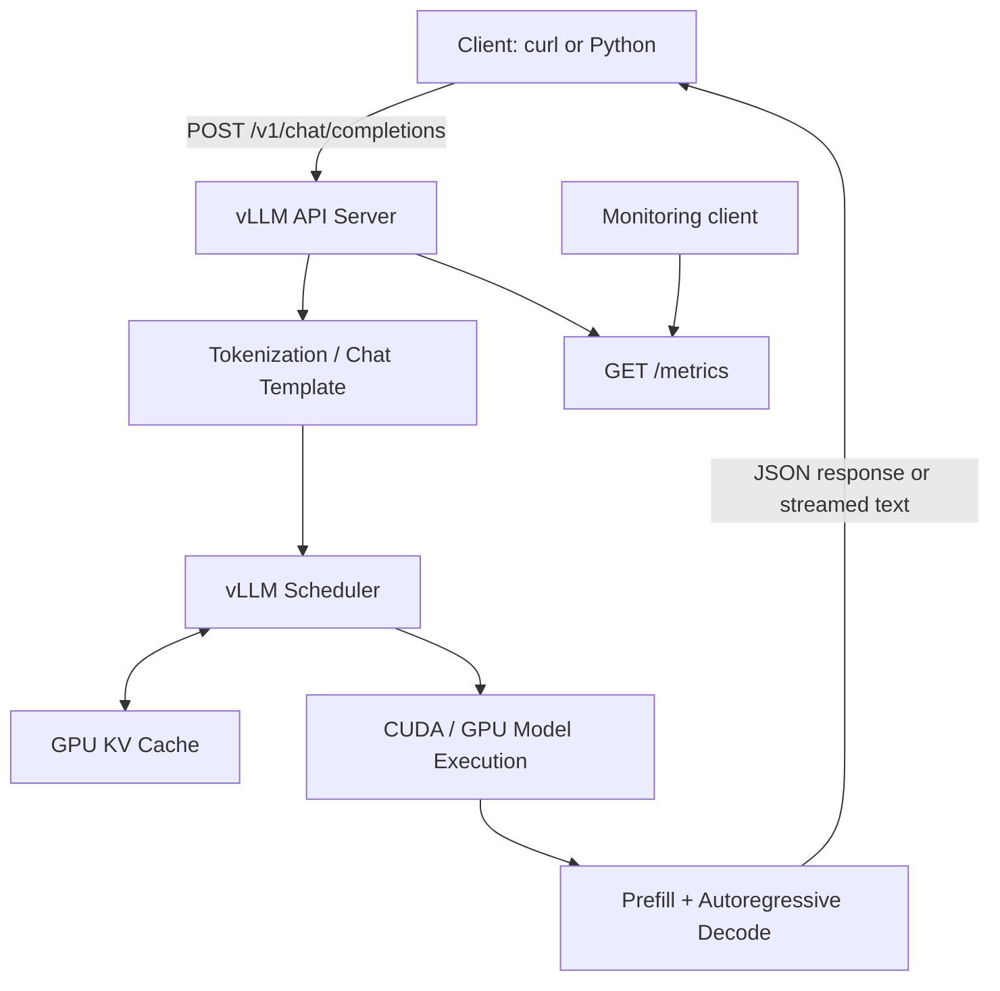

# Day 49 — GPU-Backed LLM Serving with vLLM

> **AI Infrastructure & ML Systems — 220-Day Roadmap**  
> **Phase 3: Model Serving / Inference Infrastructure** · **Day 49: LLM Serving with vLLM**

This lab deploys a small instruction-tuned language model as a persistent, GPU-backed inference service using **vLLM**. It demonstrates model startup, OpenAI-compatible HTTP inference, a Python client, non-streaming and streaming responses, client-observed latency measurement, GPU memory inspection, and a real cache-permissions troubleshooting incident.

**Status:** Local serving and single-client measurements completed. Concurrency/load testing remains a follow-on experiment for Day 50 and beyond.

## Objectives

- Run an LLM behind a persistent **OpenAI-compatible API** rather than loading it afresh for every request.
- Configure the model's context window, generation limits, and GPU resource budget.
- Verify API readiness and serve chat-completion requests using `curl` and Python.
- Measure single-client end-to-end latency and time to first visible text (TTFT).
- Inspect GPU memory and vLLM's Prometheus-compatible metrics.
- Document an actual startup failure and its resolution.

## Architecture



The server keeps model weights resident in GPU memory. **Prefill** processes the input prompt and initializes attention state; **decode** generates subsequent tokens using the accumulated KV cache. Streaming returns partial text while generation continues.

## Environment used

| Component | Recorded configuration |
|---|---|
| OS | Ubuntu Linux |
| GPU | NVIDIA GeForce RTX 3070 Laptop GPU, nominal 8 GB VRAM |
| Python | Python 3.12 in a virtual environment |
| vLLM | `0.32.0` (observed in startup logs) |
| Model | `Qwen/Qwen2.5-0.5B-Instruct` |
| Execution | CUDA, single GPU (`tensor_parallel_size=1`) |
| Weight dtype | FP16 (`--dtype half`) |
| API | `http://127.0.0.1:8000/v1` (local interface only) |

**Environment note:** The working client commands were run from the existing `ai-infra-venv`. A standard Python virtual environment works; `uv` is **not required**. Use the virtual environment in which your vLLM and Python client dependencies are installed. The log also shows a Day 49-local `.venv` during the earlier startup attempt; avoid assuming both environments have identical packages.

## Project layout

```text
day49-vllm-serving/
├── README.md                 # This document
├── client_benchmark.py       # Sequential non-streaming client
├── streaming_client.py       # Streaming TTFT client
├── day49_baseline.json       # Recorded sequential measurements
└── streaming_results.json    # Streaming measurements (latest run)
```

The scripts and JSON result files were created during the hands-on session. Place this README alongside them. The JSON file produced by the streaming script is overwritten on each run, so preserve earlier runs separately if needed.

## 1. Setup and prerequisites

Verify that the NVIDIA driver can see the GPU and that Python/PyTorch can use CUDA:

```bash
nvidia-smi
python --version
python -c "import torch; print('CUDA available:', torch.cuda.is_available())"
python -c "import vllm; print('vLLM version:', vllm.__version__)"
```

Expected results from the lab included `CUDA available: True` and vLLM `0.32.0`.

Activate **your existing, working** Python virtual environment before running the commands below. If installing into a standard venv for the first time, install compatible dependencies according to the [vLLM GPU installation guide](https://docs.vllm.ai/en/latest/getting_started/installation/gpu/); don't overwrite a working PyTorch environment unnecessarily. The Python examples also require the `openai` client package:

```bash
python -c "import openai; print(openai.__version__)"
# Only if the import fails:
python -m pip install openai
```

### GPU placement considerations

- Keep other GPU-intensive processes stopped for a clean baseline.
- Model parameters alone do not define the full VRAM requirement. Runtime, KV cache, execution buffers, and compilation/captured-graph overhead also consume GPU memory.
- The experiment is local. Binding the server to `127.0.0.1` avoids exposing an unauthenticated API to the network.

## 2. Start the vLLM server

From `day49-vllm-serving/`, run:

```bash
vllm serve Qwen/Qwen2.5-0.5B-Instruct \
  --host 127.0.0.1 \
  --port 8000 \
  --dtype half \
  --max-model-len 2048 \
  --gpu-memory-utilization 0.70 \
  --max-num-seqs 4
```

| Flag | Role |
|---|---|
| `--host 127.0.0.1` | Listens only on localhost |
| `--port 8000` | HTTP API port |
| `--dtype half` | Loads weights in FP16; BF16-to-FP16 warnings may occur for this checkpoint |
| `--max-model-len 2048` | Maximum total model sequence/context length |
| `--gpu-memory-utilization 0.70` | Target fraction of GPU memory available to the vLLM instance for its allocator/planning; not an absolute OOM guarantee |
| `--max-num-seqs 4` | Maximum sequences scheduled in one engine iteration; not a promise that four client requests always execute concurrently |

Leave this terminal running and wait until the application reports successful startup. Loading weights is **not** the same as having an API ready to accept requests; initialization may also include cache setup and compilation.

## 3. Check health and make an inference request

In another terminal:

```bash
curl -i http://127.0.0.1:8000/health
curl -fsS http://127.0.0.1:8000/v1/models
```

The lab confirmed `GET /v1/models` with **HTTP 200**. For a chat completion:

```bash
curl -sS http://127.0.0.1:8000/v1/chat/completions \
  -H 'Content-Type: application/json' \
  -d '{
    "model": "Qwen/Qwen2.5-0.5B-Instruct",
    "messages": [
      {"role": "user", "content": "Explain the difference between a CPU and GPU."}
    ],
    "max_tokens": 100,
    "temperature": 0
  }'
```

The lab confirmed `POST /v1/chat/completions` with **HTTP 200** and token-usage metadata:

```json
{
  "usage": {
    "prompt_tokens": 39,
    "completion_tokens": 100,
    "total_tokens": 139
  },
  "choices": [
    { "finish_reason": "length" }
  ]
}
```

This example shows a **length-limited** answer: `max_tokens` caps newly generated tokens, whereas `--max-model-len` limits the total sequence length (prompt plus generated tokens, subject to tokenization/chat-template overhead).

## 4. Sequential Python client and baseline

Run the `client_benchmark.py` built during the lab:

```bash
python client_benchmark.py
```

Its methodology:

1. Send one initial warmup request (excluded from saved measurements).
2. Submit **five sequential** requests with the same prompt.
3. Use `temperature=0` and a maximum of 160 generated tokens.
4. Measure client-observed end-to-end latency with `time.perf_counter()`.
5. Record prompt/output token counts, `finish_reason`, and an **effective output-token rate** defined as `output_tokens / total_request_latency`.
6. Save the observations in `day49_baseline.json`.

### Measured results — five sequential requests

| Request | End-to-end latency | Prompt tokens | Output tokens | Effective output-token rate |
|---|---:|---:|---:|---:|
| 1 | 277.3 ms | 39 | 79 | 284.85 tokens/s |
| 2 | 273.0 ms | 39 | 79 | 289.37 tokens/s |
| 3 | 270.9 ms | 39 | 79 | 291.58 tokens/s |
| 4 | 272.2 ms | 39 | 79 | 290.22 tokens/s |
| 5 | 270.0 ms | 39 | 79 | 292.61 tokens/s |

**Recorded summary:**

- **Median end-to-end latency:** 272.2 ms
- **Mean end-to-end latency:** 272.7 ms
- **Mean effective output-token rate:** approximately 289.7 output tokens/s
- **Response termination:** `finish_reason="stop"` in all five recorded requests

**Interpretation:** These are **warm-state, single-client, sequential, repeated-prompt** measurements on one small model. They are **not** concurrency throughput, production capacity, or pure decode tokens/s. The effective rate includes prefill, HTTP, and other request overhead. vLLM was configured with prefix caching enabled, so reusing the same prompt may make later requests easier than uncached requests.

## 5. Streaming client and TTFT measurements

Run:

```bash
python streaming_client.py
```

The client uses the OpenAI-compatible API with `stream=True` and processes incoming content deltas. It measures:

- **TTFT:** Client time from request start until the first **nonempty generated-text chunk** is received.
- **Total latency:** Client time until the stream finishes.
- **Content chunks:** Count of emitted text chunks. **Chunks are not guaranteed to correspond one-to-one with model tokens.**

### Recorded streaming results

| Test | Prompt topic | TTFT | Total latency | Content chunks |
|---|---|---:|---:|---:|
| Run 1 · Request 1 | GPU memory allocation | 89.0 ms | 933.6 ms | 240 |
| Run 1 · Request 2 | Kubernetes GPU scheduling | 24.5 ms | 874.7 ms | 240 |
| Run 1 · Request 3 | Model serving latency/throughput | 19.7 ms | 877.6 ms | 240 |
| Run 2 · Request 1 | GPU memory allocation | 60.2 ms | 936.8 ms | 240 |
| Run 2 · Request 2 | Kubernetes GPU scheduling | 12.3 ms | 855.3 ms | 240 |
| Run 2 · Request 3 | Model serving latency/throughput | 14.5 ms | 809.1 ms | 240 |

Each streaming request was configured with `max_tokens=240`. All six produced 240 **content chunks**, and the displayed text appeared truncated; however, the client did **not** record exact output token counts or `finish_reason`, so do **not** equate 240 chunks with 240 tokens or definitively attribute truncation without checking those fields.

The lower TTFT values on later requests may involve cache/warmup effects, but the data does not isolate a cause. These measurements are not a controlled TTFT-vs-throughput comparison, and streaming alone does not guarantee lower total latency.

## 6. GPU utilization and runtime metrics

### GPU process allocation

```bash
nvidia-smi \
  --query-compute-apps=pid,process_name,used_gpu_memory \
  --format=csv
```

Recorded while serving:

```text
pid, process_name, used_gpu_memory [MiB]
19654, VLLM::EngineCore, 5364 MiB
```

vLLM separately logged approximately **0.93 GiB** of model-loading memory. The **5,364 MiB** process figure reflects substantially more than model weight storage, including vLLM's broader GPU allocations. This is a single observation, not a memory-usage distribution or a precise breakdown of KV cache versus runtime overhead.

### vLLM metrics

```bash
curl -s http://127.0.0.1:8000/metrics \
  | grep -E '^vllm:(num_requests_running|num_requests_waiting|kv_cache_usage_perc)'
```

At the recorded sampling instant:

```text
vllm:num_requests_running ... 0.0
vllm:num_requests_waiting ... 0.0
vllm:kv_cache_usage_perc ... 0.0
```

This reflects the **idle state when sampled**; it does not mean KV caching is disabled. For longer-running workloads, observe these metrics over time and measure queueing, TTFT, decode timing, request duration, and throughput. Short requests may finish between polling intervals.

## 7. Troubleshooting incident: Hugging Face cache permissions

### Symptoms

The initial launch terminated during model download/configuration with:

```text
PermissionError: [Errno 13] Permission denied:
'/home/zakaria/.cache/huggingface/hub/models--Qwen--Qwen2.5-0.5B-Instruct'
```

### Root cause

Inspection with `namei` showed `~/.cache/huggingface` and its `hub` directory were owned by `root`, so the logged-in user could not create the model's cache directory. This was a **filesystem permission** failure, not a CUDA OOM or an invalid vLLM installation.

### Investigation and fix

```bash
namei -l ~/.cache/huggingface/hub/models--Qwen--Qwen2.5-0.5B-Instruct

# Use only if this is your personal cache and ownership should be yours:
sudo chown -R "$(id -u):$(id -g)" ~/.cache/huggingface
```

After ownership was corrected, the model downloaded, loaded into GPU memory, compiled its execution path, and reached HTTP application startup. Both `/v1/models` and `/v1/chat/completions` returned HTTP 200.

**Safer alternative when the existing cache is intentionally shared or should not be modified:**

```bash
mkdir -p "$HOME/.cache/hf-day49"
export HF_HOME="$HOME/.cache/hf-day49"
unset HF_HUB_CACHE
```

Set these environment variables **before launching vLLM**. A new cache location may trigger a fresh model download. Do not run vLLM with `sudo` as a workaround.

### Additional observations

- BF16-to-FP16 conversion warnings appeared because FP16 was explicitly requested; these warnings did **not** prevent successful model loading.
- An initial request logged a Triton JIT compilation warning (`_gumbel_sample_kernel`), which may contribute to latency spikes when the relevant execution path was not already compiled/warmed up.
- A returned `finish_reason="length"` indicates generation stopped at a configured length boundary; it is not itself an API failure.

## 8. Model quality is separate from serving health

Some generated explanations contained technical inaccuracies (for example, describing Kubernetes Pod placement in terms of generic Round Robin/LRU/Random policies). Fast token generation and HTTP 200 responses show that **serving works**, not that the model is reliable for technical explanations. For production use, evaluate output correctness independently from system latency, throughput, and reliability.

## 9. Limitations and next experiments

**What this lab establishes:** A running local vLLM API, CUDA-backed model inference, successful OpenAI-compatible chat completion, streaming, GPU-memory inspection, observable metrics, and baseline single-client latency.

**Not yet established:** Concurrent request capacity, saturated throughput, p95/p99 latency under representative traffic, precise pure decode throughput, cache-hit impact, multi-GPU performance, or production reliability.

Follow-on work:

1. **Day 50 — Continuous batching:** Send concurrent requests with varied prompt/output lengths; record queue depth, TTFT, aggregate throughput, and latency distributions.
2. Compare repeated-prompt and unique-prompt workloads, ideally controlling prefix caching.
3. Add accurate token accounting and `finish_reason` capture to the streaming script.
4. Collect GPU utilization, memory and vLLM metrics **during** load rather than only while idle.
5. Expand toward the model-serving capstone with reproducible deployment, load tests, observability, and break/fix documentation.

## Key takeaways

A healthy vLLM deployment requires more than successfully loading model weights: the API server and inference engine must initialize, GPU resources must be sufficient, and requests must satisfy the model's constraints. GPU memory covers weights **plus** KV cache and execution overhead. **TTFT** measures how quickly the user sees initial output; **end-to-end latency** measures complete request time; **throughput** describes work delivered per time interval. Streaming improves perceived responsiveness but does not automatically improve total latency. Performance claims must specify workload shape, warmup, cache behavior, concurrency, and measurement method.

## References

- [vLLM documentation](https://docs.vllm.ai/)
- [vLLM quickstart](https://docs.vllm.ai/en/latest/getting_started/quickstart/)
- [vLLM GPU installation](https://docs.vllm.ai/en/latest/getting_started/installation/gpu/)
- [Qwen2.5-0.5B-Instruct model card](https://huggingface.co/Qwen/Qwen2.5-0.5B-Instruct)

---

*Part of the 220-Day AI Infrastructure & ML Systems learning roadmap. All performance values above are from the local Day 49 lab; no multi-user or cloud performance figures are claimed.*
