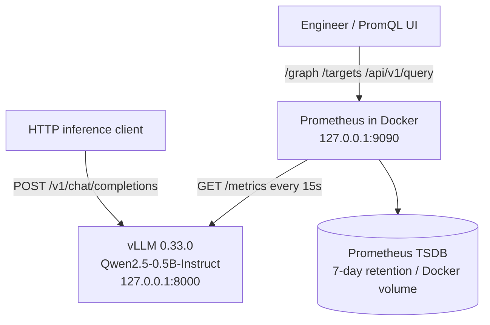
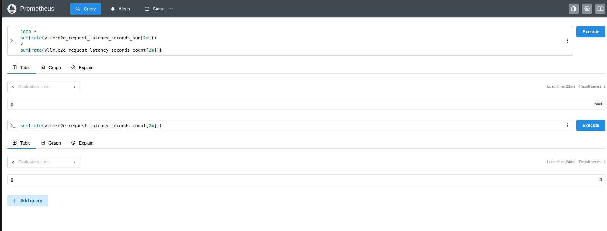
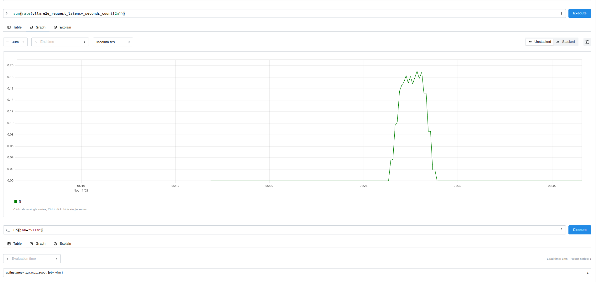

# Day 57 — Prometheus Monitoring for vLLM

**AI Infrastructure & ML Systems · Phase 4: Observability · Day 57/220**

> **Goal:** Collect, query, and interpret real inference telemetry from a running vLLM server using a locally deployed Prometheus instance. Includes a controlled target-failure experiment and documented troubleshooting.

## What was accomplished

The existing **vLLM 0.33.0** server hosted **`Qwen/Qwen2.5-0.5B-Instruct`** at `127.0.0.1:8000`. A Prometheus container scraped the native vLLM `/metrics` endpoint every 15 seconds using a local, host-networked configuration.

**Actual observations from the Day 57 experiment:**

| Validation | Recorded evidence |
| --- | --- |
| vLLM `/health` and `/metrics` | HTTP 200 responses |
| Prometheus container | Running (`docker compose ps`) |
| Config validation | `promtool check config` → `SUCCESS` |
| Prometheus readiness | `Prometheus Server is Ready.` |
| Initial vLLM target status | `up{job="vllm"} = 1` |
| Inference request test | **20/20 HTTP 200** responses, sent sequentially at ~2-second spacing |
| Observed request counter after test | `sum(vllm:e2e_request_latency_seconds_count) = 20` |
| Historical 2-minute completion rate | Positive during the test, ~**0.19 requests/s** at the graph's apparent peak |
| Idle completion rate | `0 requests/s` at the observed evaluation time |
| Idle rolling mean latency | `NaN` at the observed evaluation time (division by zero when no requests completed) |
| Deliberate target outage | `up{job="vllm"}` transitioned **1 → 0** |
| vLLM service restart | `/health` returned HTTP 200 again |
| Prometheus confirms recovery (`up` returns 1) | **Not yet recorded** in the provided outputs; verify with the query below |

**Interpretation caveat:** The ~0.19 requests/s value is an approximate graph reading of a *rolling two-minute average* during deliberately paced sequential traffic, **not** a maximum throughput benchmark. The cumulative count and time-window rate answer different questions. Inference availability is not proven by `up=1` alone; that signal only confirms Prometheus could scrape its target.

## Architecture



**Platform assumptions:** Ubuntu/Linux workstation; vLLM on the host loopback; Docker Engine with Docker Compose. Prometheus uses Docker `network_mode: host` so `127.0.0.1:8000` refers to the same Linux host as the vLLM process. The Prometheus UI listens on host loopback only. This is a **single-host learning configuration**, not a distributed/production-hardened deployment.

## Files

```text
day57-prometheus/
├── README.md
├── compose.yaml
├── prometheus.yml
├── .gitignore
├── scripts/
│   └── send-traffic.sh
└── evidence/
    ├── idle-latency-nan-and-rate-zero.png
    └── historical-request-rate-and-target-up.png
```

## Prerequisites

1. Linux with Docker Engine and `docker compose`.
2. Existing vLLM Python environment and a model served at `127.0.0.1:8000`.
3. `curl` and Python 3 for API checks. A GPU and suitable vLLM setup are needed for the inference workload.
4. Ports `8000` and `9090` available locally.

**Model server:** Activate the pre-existing environment (`activate-ai` was used in this lab) and start the previously tested vLLM server command. The model loaded during the recorded experiment was `Qwen/Qwen2.5-0.5B-Instruct`. The exact serving flags from the live run were not captured in the submitted evidence; do not treat sample flags as experimentally verified.

Confirm the application before deploying monitoring:

```bash
curl -fsS -o /dev/null -w 'health_http=%{http_code}\n' http://127.0.0.1:8000/health
curl -fsS http://127.0.0.1:8000/metrics | grep -m 5 '^vllm:'
curl -fsS http://127.0.0.1:8000/v1/models | python3 -m json.tool
```

## Deploy Prometheus

From this directory:

```bash
docker compose config
docker compose up -d
docker compose ps
docker compose exec prometheus promtool check config /etc/prometheus/prometheus.yml
curl -fsS http://127.0.0.1:9090/-/ready
```

- **Prometheus UI:** <http://127.0.0.1:9090/graph>
- **Target health:** <http://127.0.0.1:9090/targets>

The included `prometheus.yml` configures `prometheus` and `vllm` scrape jobs at **15-second intervals**. The supplied `compose.yaml` uses the same `prom/prometheus:latest` tag as the original working lab, and persists data using the `day57-prometheus_prometheus_data` Docker volume for up to seven days of TSDB retention. **For reproducible deployments, resolve the tested image digest or version and replace `latest`**; this snapshot does not claim a verified fixed image version.

Verify the target using the API:

```bash
curl -fsSG 'http://127.0.0.1:9090/api/v1/query' \
  --data-urlencode 'query=up{job="vllm"}' | python3 -m json.tool
```

Expected on a successful recent scrape: `"1"`. `"0"` means the latest scrape failed. If the query returns no series, investigate discovery, query time, and metric availability.

## Reproduce the 20-request smoke test

```bash
./scripts/send-traffic.sh
# Optional: REQUESTS=20 DELAY=2 ./scripts/send-traffic.sh
```

The provided script sends a sequential OpenAI-compatible chat-completion request, waits two seconds after each request, and displays each HTTP status. It returns nonzero if any request fails. It is **not a concurrency/peak-load benchmark**.

After the requests, wait for a Prometheus scrape and evaluate the following in the Prometheus UI:

## PromQL queries

**Target scrape success:**

```promql
up{job="vllm"}
```

**Cumulative completed-request observations:**

```promql
sum(vllm:e2e_request_latency_seconds_count)
```

**Completed requests per second over a two-minute moving window:**

```promql
sum(rate(vllm:e2e_request_latency_seconds_count[2m]))
```

**Five-minute total completion-rate estimate:**

```promql
sum(rate(vllm:e2e_request_latency_seconds_count[5m]))
```

**Average end-to-end latency (milliseconds), over a two-minute window:**

```promql
1000 *
sum(rate(vllm:e2e_request_latency_seconds_sum[2m]))
/
sum(rate(vllm:e2e_request_latency_seconds_count[2m]))
```

**Estimated P95 latency (seconds) from classic histogram buckets, if exported:**

```promql
histogram_quantile(
  0.95,
  sum by (le) (
    rate(vllm:e2e_request_latency_seconds_bucket[5m])
  )
)
```

**Instantaneous running and waiting requests (gauges):**

```promql
sum(vllm:num_requests_running)
sum(vllm:num_requests_waiting)
```

**Counter resets detected over an hour:**

```promql
sum(resets(vllm:e2e_request_latency_seconds_count[1h]))
```

**Scrape diagnostics:**

```promql
scrape_duration_seconds{job="vllm"}
scrape_samples_scraped{job="vllm"}
```

> **Remember:** use `sum(rate(counter[5m]))` rather than `rate(sum(counter)[5m])`; rates must be calculated *per original series* so that Prometheus can detect counter resets correctly. A `NaN` rolling mean with a zero completion rate may simply indicate an idle observation window. An empty result is different from `NaN` and requires checking series availability and sufficient samples.

## Screenshots from the actual lab

**Query evaluation during the idle period:**



**Historical traffic spike and successful target scrape:**



Screenshots show the observed results in the user-provided Prometheus interface, not simulated metrics.

## Controlled failure / recovery

1. Confirm `up{job="vllm"} = 1`.
2. Stop only the vLLM server using Ctrl+C in its terminal. **Leave Prometheus running.**
3. After Prometheus has attempted another scrape (configured interval: 15 seconds), query `up{job="vllm"}`; recorded result was `0`.
4. Restart the vLLM server and verify `curl -fsS -o /dev/null -w '%{http_code}\n' http://127.0.0.1:8000/health` prints `200`.
5. Query `up{job="vllm"}` after a subsequent successful scrape and **record whether it returned `1`** (not yet present in supplied evidence).
6. Graph `up{job="vllm"}` over the experiment period to visualize 1 → 0 → 1, if the final verification succeeds.

A healthy `/health` request and `up=0` can coexist briefly because the scrape is periodic; additionally, `/health` and `/metrics` have different behavior, so investigate target errors if `up` stays zero.

## Operational troubleshooting

| Symptom | What it means / first action |
| --- | --- |
| `up=0`, `/health` fails | Check vLLM process, logs, port 8000, and startup/errors |
| `up=0`, `/health` works | Check `/metrics`, `/targets` last error, scrape timeout, host networking, and wait for next scrape |
| `up=1`, throughput = 0 | Check whether clients sent traffic; compare running/waiting gauges and client HTTP responses |
| Latency = `NaN` | Check whether the two-minute window contains completions; denominator may be zero |
| Request counter decreases | Restart/reset likely; use `rate()` before `sum()`; inspect `resets()` |
| Query returns no series | Confirm exact metric name, labels, active model, vLLM version, and time range |
| Prometheus container won't start | `docker compose logs --tail=100 prometheus`; validate YAML and host port availability |

## Engineering decisions and limitations

- **Scrape interval:** 15 seconds balances a useful lab time resolution against monitoring overhead.
- **Storage:** A named Docker volume keeps TSDB data across container recreation; deleting the volume removes the stored history.
- **Security:** HTTP endpoints are bound to loopback, but host networking is broader than necessary for a hardened deployment. Do not publish the local Prometheus UI externally without access controls.
- **Image tag:** `latest` is not reproducible across time; pin an approved Prometheus release or digest before declaring this production-ready.
- **Limitations:** Only one local vLLM instance, no measured multi-replica aggregation, no GPU exporter yet, no Grafana dashboard or alerting rules yet, no proven load ceiling, and no verified final `up=1` observation after the recovery in the provided evidence.
- **Next lessons:** Day 58 Kubernetes metrics; Day 59 GPU/DCGM metrics; Day 60 Grafana.

## Documentation / references

- [Prometheus configuration](https://prometheus.io/docs/prometheus/latest/configuration/configuration/)
- [Prometheus PromQL functions: `rate()` and `resets()`](https://prometheus.io/docs/prometheus/latest/querying/functions/)
- [Prometheus metric types](https://prometheus.io/docs/tutorials/understanding_metric_types/)
- [vLLM production metrics](https://docs.vllm.ai/en/latest/usage/metrics/)
- [Docker Compose networking modes](https://docs.docker.com/compose/how-tos/networking/)

## Clean shutdown

```bash
# Stop Prometheus without deleting the persistent time-series volume:
docker compose down

# WARNING: Only when intentionally deleting lab history:
# docker compose down -v
```

## Interview-ready project summary

> I instrumented a local Qwen2.5 vLLM inference service using Prometheus, configured 15-second metric scrapes and persistent time-series storage, and validated the integration with 20 successful inference requests. I used PromQL to interpret completion-rate history and explain why an idle workload yielded zero throughput and undefined rolling average latency. I then induced a controlled service outage and observed Prometheus detect the change from `up=1` to `up=0`, followed by an application-level health recovery. The setup and troubleshooting procedures are reproducible with Docker Compose.
