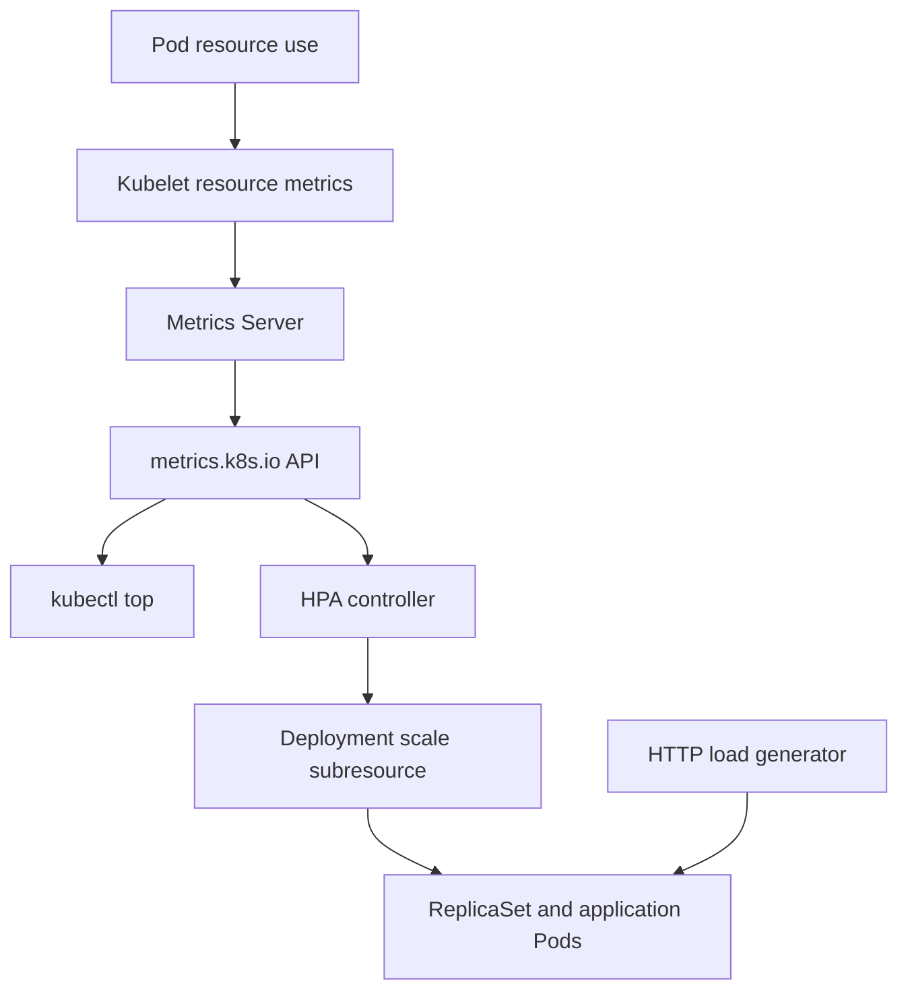

# Day 58 — Kubernetes Resource Metrics and CPU-Based HPA

**Learning track:** AI Infrastructure & ML Systems (220-day roadmap)  
**Phase:** Observability · **Day:** 58  
**Lab environment:** Minikube `gpu-lab` (Docker driver), Kubernetes v1.35.1, Ubuntu 24.04 host  
**Status:** Metrics API, CPU-load experiment, HPA scale-up, and HPA scale-down **verified**. Final namespace cleanup **not yet confirmed**.

## Objectives

1. Distinguish container usage metrics, Kubernetes object-state metrics, and application metrics.
2. Install and validate the Kubernetes resource-metrics pipeline.
3. Measure CPU and memory consumption using `kubectl top` and the Metrics API.
4. Demonstrate the difference between CPU requests, limits, and actual consumption.
5. Configure an `autoscaling/v2` HPA and observe how traffic influences replica counts.
6. Diagnose and document realistic Kubernetes monitoring incidents.

## Architecture



The Metrics Server pipeline is designed for recent CPU/memory metrics, not long-term storage. A separate Prometheus monitoring path can scrape exporters (including kube-state-metrics) and retain time-series history.

## Environment and prerequisites

- Existing Minikube profile: `gpu-lab` (single node `gpu-lab`)
- Metrics Server addon enabled (`registry.k8s.io/metrics-server/metrics-server:v0.8.1`)
- Metrics API registered and available: `v1beta1.metrics.k8s.io`
- NVIDIA device plugin present; GPU exposure is independent of the resource-metrics API

```bash
minikube -p gpu-lab status
kubectl config current-context  # expected: gpu-lab
kubectl get apiservice v1beta1.metrics.k8s.io
kubectl top nodes
kubectl top pods -A
```

## Incident 1 — Metrics Server blocked by a GPU-node taint

**Symptom:** `kubectl top` failed with `Metrics API not available` and the addon was disabled.  
**First fix:** `minikube -p gpu-lab addons enable metrics-server`.  
**Next symptom:** Metrics Server Pod remained `Pending` and `APIService` reported `MissingEndpoints`.

**Root cause observed in scheduler events:**

```text
0/1 nodes are available: 1 node(s) had untolerated taint(s).
```

The sole node had `dedicated=gpu:NoSchedule`; the Metrics Server Pod lacked a matching toleration. For this **single-node learning cluster**, the taint was removed:

```bash
kubectl taint nodes gpu-lab dedicated=gpu:NoSchedule-
```

**Outcome:** Metrics Server scheduled to `gpu-lab` and became `Running 1/1`. On a production multi-node GPU cluster, it would usually be preferable to preserve deliberate GPU-node isolation and configure monitoring placement / tolerations appropriately.

## Incident 2 — APIService readiness during startup

After scheduling succeeded, the APIService briefly reported `False (FailedDiscoveryCheck)` even though the Pod was `Running 1/1`.

The initial Metrics Server log included:

```text
Failed probe: metric-storage-ready — no metrics to serve
```

**Observed resolution:** A subsequent `kubectl describe apiservice` reported `Available=True`, `Reason=Passed`, `Message=all checks passed`. The Service `10.109.103.150:443` had endpoint `10.244.0.44:4443`, and both `kubectl top` and the raw Metrics API subsequently returned data. No extra TLS or networking changes were necessary.

**Engineering lesson:** Pod readiness, aggregated API availability, and functional query success are separate checkpoints; an early probe failure need not indicate a persistent fault.

## Experiment 1 — CPU busy-loop Pod

Manifest: [`cpu-load.yaml`](./cpu-load.yaml).

```bash
kubectl apply -f cpu-load.yaml
kubectl wait --for=condition=Ready pod/cpu-metrics-demo --timeout=120s
kubectl top pod cpu-metrics-demo
kubectl top nodes
kubectl get --raw /apis/metrics.k8s.io/v1beta1/namespaces/default/pods/cpu-metrics-demo \
  | python3 -m json.tool
```

### Recorded observations (from actual terminal output)

| Measurement | Value | Interpretation |
|---|---:|---|
| CPU request | `100m` | Scheduling request, **not** a usage cap |
| CPU limit | `500m` | CPU quota / sustained consumption cap |
| Pod CPU (`kubectl top`) | `501m` | Approximately half a core; near the configured limit |
| Raw Pod CPU | `499985184n` | ~499.985m at a nearby sampling point |
| Raw Pod memory | `432Ki` | Under 1 MiB; `kubectl top` displayed `0Mi` |
| Node CPU before load | `139m` | Baseline snapshot |
| Node CPU with load | `612m` | Snapshot during CPU experiment |

At ~500m measured usage with a 100m request, utilization relative to request is ~500%. The 501m display near a 500m limit does not, by itself, imply that the CPU limit was disabled: metrics collection and quota accounting differ in timing and precision.

Stop this busy loop after measuring:

```bash
kubectl delete pod cpu-metrics-demo --ignore-not-found
```

## Experiment 2 — HTTP load and HPA

Manifests: [`hpa-app.yaml`](./hpa-app.yaml) and [`hpa.yaml`](./hpa.yaml).

```bash
kubectl create namespace day58 --dry-run=client -o yaml | kubectl apply -f -
kubectl apply -f hpa-app.yaml
kubectl rollout status deployment/php-apache -n day58 --timeout=180s
kubectl apply -f hpa.yaml
kubectl get hpa -n day58
kubectl run load-generator -n day58 --image=busybox:1.36 --restart=Never \
  --command -- /bin/sh -c \
  'while true; do wget -q -O /dev/null http://php-apache; done'
kubectl describe hpa php-apache -n day58
```

The application has a per-Pod CPU request of `200m` and a CPU limit of `500m`. HPA target is **50% CPU utilization**, with **1–4 replicas**.

### Confirmed scale-up results

| Observation | Recorded value |
|---|---|
| Initial Deployment | `1/1` available |
| Application CPU under load | `340m` on one sampled Pod |
| HPA observed CPU utilization | `170%` (target: `50%`) |
| HPA event | `SuccessfulRescale`: `New size: 4` |
| HPA after scaling | `4 current / 4 desired` |
| HPA scaling metric condition | `ScalingActive=True`, `ValidMetricFound` |
| Startup warning | Missing CPU metrics for targeted Pods that might be unready |

Illustrative calculation using the 170% sample and an initial single replica:

`ceil(1 × 170 / 50) = 4` desired replicas.

This illustrates the scaling logic; it is **not** a reconstruction of the exact instantaneous samples used by the controller.

### Confirmed scale-down results

The load generator was deleted:

```bash
kubectl delete pod load-generator -n day58 --ignore-not-found
```

Immediately after stopping load, one `kubectl get hpa` reading showed `78%/50%` with 4 replicas. A subsequent `describe` showed `40% (80m)/50%` and `4 current / 4 desired`, with `AbleToScale=True, ScaleDownStabilized`, meaning earlier higher recommendations were temporarily retained. Note that `ceil(4 × 40 / 50) = 4`, so merely falling below target was not sufficient by itself to require a replica reduction.

**Final verification from user's terminal output:**

```text
Metrics:         resource cpu on pods: 0% (1m) / 50%
Min replicas:    1
Max replicas:    4
Deployment pods: 1 current / 1 desired
AbleToScale:     True  ReadyForNewScale
ScalingActive:   True  ValidMetricFound
ScalingLimited:  True  TooFewReplicas
Normal SuccessfulRescale  New size: 4; reason: cpu resource utilization (percentage of request) above target
Normal SuccessfulRescale  New size: 1; reason: All metrics below target

NAME                          READY   STATUS    RESTARTS
php-apache-7985cc77f8-7hxsk   1/1     Running   0
```

**Outcome:** Full autoscaling lifecycle verified: **1 → 4 → 1 replicas**. The `TooFewReplicas` condition reflects that the utilization-based recommendation would be lower than the configured `minReplicas: 1`; it is expected when the application is idle. The reported `0%` is a rounded utilization, and raw usage was approximately `1m`, not zero. The scale-down event was reported as **9m24s old at the time of the final snapshot**; the exact elapsed time since the load generator was removed was not measured.

Details and a focused evidence excerpt are in [`evidence/scale-down-results.md`](./evidence/scale-down-results.md). The final namespace deletion still needs confirmation.

## Cleanup (after capturing evidence)

```bash
kubectl delete pod load-generator -n day58 --ignore-not-found
kubectl delete pod cpu-metrics-demo --ignore-not-found
kubectl delete namespace day58 --ignore-not-found
kubectl get namespace day58
```

The last command should eventually return `NotFound` once namespace deletion finishes. Keep Metrics Server enabled for Day 59 onward. Do **not** recreate or delete your `gpu-lab` cluster.

## Troubleshooting checklist

1. **`kubectl top`: Metrics API not available** — Check addon status, deployment, and APIService registration.
2. **Metrics Server `Pending`** — Run `kubectl describe pod` and read `FailedScheduling` events; check taints, tolerations, and node resource requests.
3. **APIService `MissingEndpoints`** — Check Pod readiness, Service selectors, ports, and EndpointSlices.
4. **APIService `FailedDiscoveryCheck`** — Read the exact APIService condition and Metrics Server logs; verify whether it resolves after initialization.
5. **HPA shows `<unknown>`** — Check Pod readiness, per-container CPU requests, resource metrics, and HPA events.
6. **No immediate scale-down** — Inspect utilization, missing metrics, recent recommendations, scale-down stabilization, and min/max replica limits.

## Verification and portfolio evidence

- [x] Metrics Server installed and Pod ready
- [x] APIService `Available=True`
- [x] `kubectl top nodes` and `kubectl top pods -A` return measurements
- [x] Raw `NodeMetrics` and `PodMetrics` JSON examined
- [x] CPU load reached approximately 500m
- [x] HPA scaled Deployment from one to four replicas
- [x] Delayed scale-down / stabilization condition observed
- [x] Lower replica count after traffic stops: one replica with recorded `SuccessfulRescale` event
- [ ] Experimental namespace cleaned up **(confirm after running commands)**

## Interview takeaways

- Explain why `requests` are scheduling inputs, `limits` are enforcement settings, and `usage` is observed reality.
- Trace `kubelet → Metrics Server → metrics.k8s.io → HPA → Deployment → ReplicaSet → Pod`.
- Differentiate `MissingEndpoints` from `FailedDiscoveryCheck`.
- Recognize the difference between a scheduled/running Pod, a ready Pod, and a functioning metrics API.
- Discuss why CPU utilization relative to requests can exceed 100% and why HPA protects against scaling flaps.

## References

- [Kubernetes resource metrics pipeline](https://kubernetes.io/docs/tasks/debug/debug-cluster/resource-metrics-pipeline/)
- [Horizontal Pod Autoscaling](https://kubernetes.io/docs/concepts/workloads/autoscaling/horizontal-pod-autoscale/)
- [Official HPA walkthrough](https://kubernetes.io/docs/tasks/run-application/horizontal-pod-autoscale-walkthrough/)
- [Metrics Server project](https://github.com/kubernetes-sigs/metrics-server)

---

**Assessment results:** Section 1 = 10/10, Section 2 = 10/10, Section 3 = 10/10. Total **30/30**.
