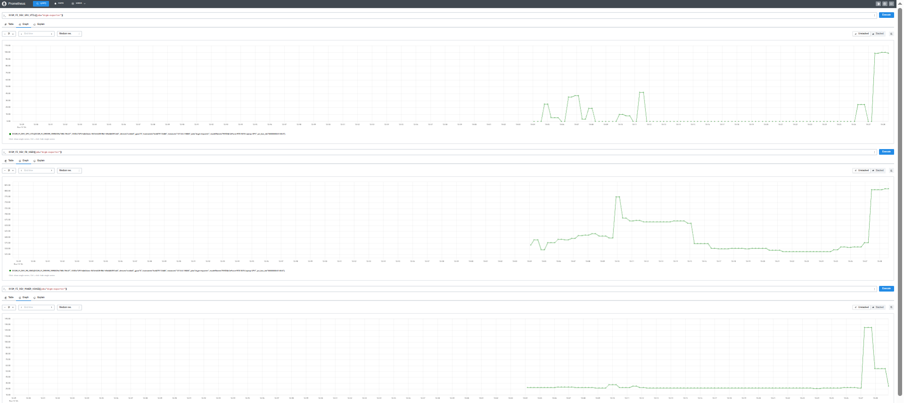
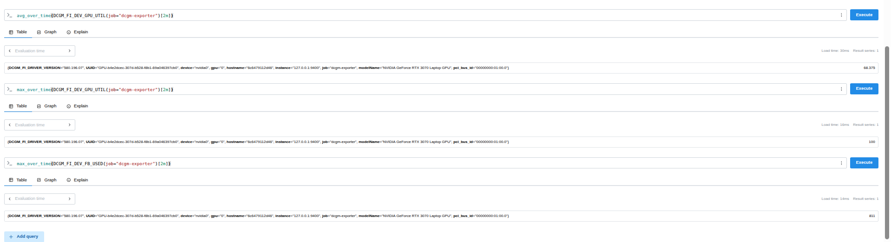

# Day 59 — GPU Observability with NVIDIA DCGM Exporter and Prometheus

> **Status:** Tested on a single NVIDIA GeForce RTX 3070 Laptop GPU (8 GiB) on 2026-11-13. The standalone DCGM exporter and host-networked Prometheus integration were verified. This repository is a reproducible *single-node monitoring lab*, not a claim of a multi-GPU production deployment.

## What this project demonstrates

- Exporting supported NVIDIA GPU hardware telemetry using **DCGM Exporter**.
- Collecting GPU metrics in **Prometheus**, using a host-networked Prometheus container and a loopback-published exporter.
- Using **PromQL** to compare idle and compute-intensive periods.
- Recognizing missing or implausible GPU fields instead of treating every exported sample as ground truth.
- Diagnosing monitoring failures using a layered runbook.

## Architecture

```text
  RTX 3070 Laptop GPU
         |
    NVIDIA driver / NVML / DCGM
         |
    DCGM Exporter 4.8.4
    Docker bridge container
    127.0.0.1:9400 -> container:9400
         ^    Prometheus HTTP scrape every 15 seconds
         |
    Prometheus (host networking)
    127.0.0.1:9090
       |               \
       |                \---- vLLM target :8000 (DOWN during this lab)
       +---- PromQL, time-series queries, target-health UI

  Optional future extension: Grafana dashboards (Day 60)
```

**Important networking detail:** Prometheus uses `network_mode: host`; therefore `127.0.0.1:9400` from Prometheus reaches the host's loopback interface. A default bridge-networked Prometheus container cannot use *its own* `127.0.0.1` to reach a different container.

## Verified environment

| Component | Reported version / state |
|---|---|
| GPU | NVIDIA GeForce RTX 3070 Laptop GPU, 8,192 MiB |
| NVIDIA driver | 580.196.07 |
| `nvidia-smi` CUDA compatibility | 13.0 (driver-reported; not a toolkit installation claim) |
| Docker | 29.9.2 |
| NVIDIA Container Toolkit | 1.20.1 |
| PyTorch in `ai-infra-venv` | 2.14.0+cu130; `torch.cuda.is_available() == True` |
| DCGM exporter image | `nvcr.io/nvidia/k8s/dcgm-exporter:4.6.1-4.8.4` |
| Prometheus container | `day57-prometheus`; host networking |
| Exporter container | `day59-dcgm-exporter`; bridge networking and loopback-published port |
| Prometheus configuration | `~/ai-infra/day57-prometheus/prometheus.yml` |

## Reproduce the exporter deployment

Prerequisites: a visible NVIDIA GPU, functioning driver, Docker and NVIDIA Container Toolkit.

```bash
nvidia-smi
nvidia-ctk --version
docker info --format '{{json .Runtimes}}' | grep -o 'nvidia'

# Local, trusted lab only; SYS_ADMIN is a powerful capability.
docker run -d --rm \
  --name day59-dcgm-exporter \
  --gpus all \
  --cap-add SYS_ADMIN \
  -p 127.0.0.1:9400:9400 \
  nvcr.io/nvidia/k8s/dcgm-exporter:4.6.1-4.8.4

# Verify the exporter before changing Prometheus.
docker logs --tail 50 day59-dcgm-exporter
curl -fsS http://127.0.0.1:9400/metrics | grep '^DCGM_' | head
```

The `--cap-add SYS_ADMIN` setting follows NVIDIA's documented container example, but it should be security-reviewed before production use. Do not expose the metrics endpoint publicly without access controls.

## Prometheus integration (preserve existing jobs)

The existing Day 57 configuration monitored Prometheus itself on `:9090` and vLLM on `:8000`. This lab appended the DCGM job, as shown in [`config/dcgm-scrape-job.yml`](config/dcgm-scrape-job.yml):

```yaml
  - job_name: "dcgm-exporter"
    scrape_interval: 15s
    metrics_path: /metrics
    static_configs:
      - targets: ["127.0.0.1:9400"]
```

This is a **YAML fragment under the existing `scrape_configs:` list**, not a complete stand-alone Prometheus configuration.

```bash
CFG="$HOME/ai-infra/day57-prometheus/prometheus.yml"
cp "$CFG" "${CFG}.day59.bak"
# Append the job under scrape_configs, preserving other jobs.
docker exec day57-prometheus promtool check config /etc/prometheus/prometheus.yml
docker kill --signal=HUP day57-prometheus
curl -fsSG 'http://127.0.0.1:9090/api/v1/query' \
  --data-urlencode 'query=up{job="dcgm-exporter"}' | python3 -m json.tool
```

**Observed:** `up{job="dcgm-exporter"}` returned `1`. The GPU utilization query returned a labeled sample with value `0` in the idle period. The Prometheus targets screenshot showed DCGM `UP`, Prometheus `UP`, and vLLM `DOWN` because `127.0.0.1:8000` refused connections. This does not break the DCGM job.

## Controlled compute experiment

The lab used a CUDA-enabled PyTorch process performing repeated 2048 × 2048 matrix multiplications with `torch.cuda.synchronize()`. The experiment is included in [`scripts/gpu_workload.py`](scripts/gpu_workload.py) as a reproducible script matching the method used in the guided lab (the user's exact local file was not exported).

```bash
# In the AI-infrastructure Python environment with working CUDA PyTorch
python3 scripts/gpu_workload.py
```

### Actual measured values

| Observation | Measurement | Scope |
|---|---:|---|
| Workload duration | 90.00 s | PyTorch terminal |
| Completed matrix multiplications | 21,777 | PyTorch terminal |
| Completed matrix multiplications/s | 241.96 | PyTorch terminal |
| `avg_over_time(DCGM_FI_DEV_GPU_UTIL[2m])` | 68.375% | Two-minute rolling window at screenshot evaluation time |
| `max_over_time(DCGM_FI_DEV_GPU_UTIL[2m])` | 100% | Two-minute rolling window at screenshot evaluation time |
| `max_over_time(DCGM_FI_DEV_FB_USED[2m])` | 811 MiB | Two-minute rolling window at screenshot evaluation time |
| Earlier idle `DCGM_FI_DEV_FB_USED` | 502 MiB | Different earlier scrape |
| Earlier idle power | ~21.7 W | Earlier DCGM sample |

**Interpretation, not overclaim:** the 2-minute average includes whichever idle/active samples fall into the chosen evaluation window; it is not the compute-only average. GPU utilization is not FLOPS utilization. The completed matrix-multiplications/s result is **not LLM tokens/s**, **not request throughput**, and **not a controlled cross-device GPU benchmark**. A rough 309 MiB difference between the earlier idle framebuffer sample and the reported peak is descriptive only, not an exact isolated process memory allocation.





## Useful PromQL

```promql
up{job="dcgm-exporter"}
DCGM_FI_DEV_GPU_UTIL{job="dcgm-exporter"}
DCGM_FI_DEV_FB_USED{job="dcgm-exporter"}
DCGM_FI_DEV_POWER_USAGE{job="dcgm-exporter"}
DCGM_FI_DEV_GPU_TEMP{job="dcgm-exporter"}
avg_over_time(DCGM_FI_DEV_GPU_UTIL{job="dcgm-exporter"}[2m])
max_over_time(DCGM_FI_DEV_GPU_UTIL{job="dcgm-exporter"}[2m])
max_over_time(DCGM_FI_DEV_FB_USED{job="dcgm-exporter"}[2m])
```

Basic metric units in the exporter used for this lab: `DCGM_FI_DEV_FB_USED` in **MiB**; utilization in **%**; GPU temperature in **°C**; board power in **W**. Check `# HELP` and the active collector for other versions; names and unit conventions can differ.

## Hardware-specific caveats

1. `DCGM_FI_PROF_*` profiling fields were **skipped**: log reported `Profiling is not supported for this group of GPUs or GPU`. Avoid treating unsupported profiling fields as zeros.
2. `DCGM_FI_DEV_MEMORY_TEMP` returned `0`. Do not present it as a real GPU memory temperature; mark it *unverified / not usable* on this machine.
3. Both `nvidia-smi` and DCGM repeatedly reported memory activity of `100%` with ~0–6% GPU compute utilization, ~22 W board power, and ~58°C GPU temperature at idle. This agreement establishes repeated reporting, **not** physical memory-bandwidth saturation. Treat memory activity as needing independent validation before basing alerts or optimization claims on it.
4. Exporter reported no NVSwitch and did not load DCGM CPU core metrics. Those are not defects in this single-laptop GPU lab.
5. `hostname` in exported labels was the container hostname, not necessarily the host machine's human-readable name. Consider a stable `instance` / external label scheme in larger deployments.
6. `--rm` means the exporter container will be removed when stopped; this local lab configuration does not implement automatic restart or high availability.

## Break/fix runbook

| Symptom | First checks | Likely remediation |
|---|---|---|
| `up{job="dcgm-exporter"} == 0` | `docker ps`; `docker logs`; `curl -v 127.0.0.1:9400/metrics`; Target error in Prometheus | Restore exporter health, verify binding/port or correct target networking |
| Target missing entirely | Prometheus YAML, `promtool check config`, reload logs | Add job under `scrape_configs`, validate, send `SIGHUP` |
| GPU metrics missing, endpoint healthy | `grep '^DCGM_'`; NVIDIA runtime; collector file; exporter logs | Confirm GPU visible and field supported; avoid inventing zero samples |
| CPU or LLM metrics DOWN | Test corresponding `:8000/metrics`; process status | Start/repair that independent service; don't confuse with exporter health |
| 100% memory activity at idle | Cross-check with `nvidia-smi`, workload presence, clocks, power, sampling | Document discrepancy; don't claim bandwidth saturation without proof |
| Rising GPU temperature and worse performance | Temperature + clocks + throttle indicators + throughput | Check cooling/power limits and corroborate actual throttling |
| `nvidia-smi` works but container cannot see GPU | `nvidia-ctk --version`, Docker runtimes, exporter logs | Correct container runtime configuration and restart/exporter as appropriate |

### Fast triage commands

```bash
docker ps --filter name=day59-dcgm-exporter
docker logs --tail 80 day59-dcgm-exporter
curl -fsS http://127.0.0.1:9400/metrics | grep '^DCGM_FI_DEV_GPU_UTIL'
docker exec day57-prometheus promtool check config /etc/prometheus/prometheus.yml
docker logs --tail 30 day57-prometheus
curl -fsSG 'http://127.0.0.1:9090/api/v1/query' --data-urlencode 'query=up{job="dcgm-exporter"}'
nvidia-smi
```

## Security and reproducibility

Local port 9400 was deliberately restricted to `127.0.0.1`. `SYS_ADMIN` capability is high privilege. Review privileges and monitoring endpoint access before deploying on shared infrastructure. The configuration file on the workstation was backed up before editing; Prometheus was reloaded by sending `SIGHUP`, preserving its persistent TSDB volume. No GPU cloud resources were used.

## References

- NVIDIA DCGM Exporter: https://docs.nvidia.com/datacenter/cloud-native/gpu-telemetry/latest/dcgm-exporter.html
- NVIDIA DCGM Exporter installation: https://docs.nvidia.com/datacenter/dcgm/latest/installation/install-dcgm-exporter.html
- NVIDIA DCGM metric inventory: https://docs.nvidia.com/datacenter/dcgm/latest/reference/dcgm-exporter-metrics.html
- Prometheus configuration and reload: https://prometheus.io/docs/prometheus/latest/configuration/configuration/
- Prometheus PromQL functions: https://prometheus.io/docs/prometheus/latest/querying/functions/

**Evidence:** screenshot files under `docs/images/` were supplied from the actual Day 59 session. All quoted measurements above are from the user's terminal output or Prometheus result screenshots, not synthetic benchmark claims.
