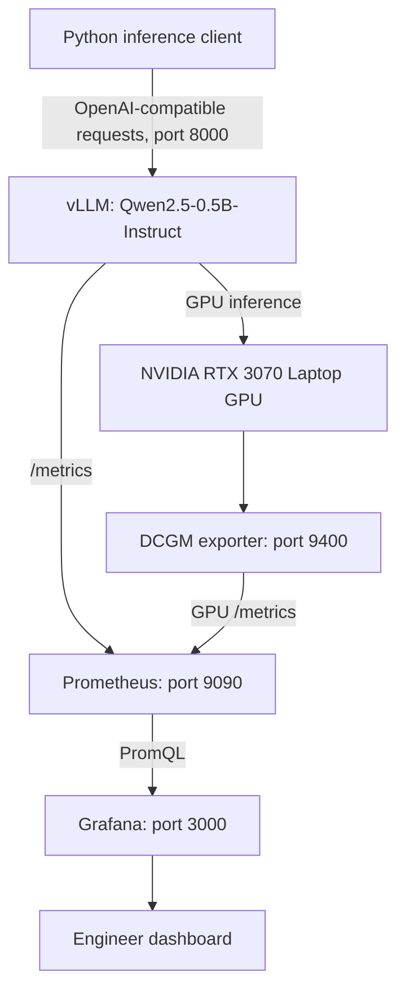

# Day 60 — Grafana Observability for GPU/LLM Serving

A hands-on AI Infrastructure project using **Prometheus + NVIDIA DCGM exporter + vLLM + Grafana** on a single NVIDIA GeForce RTX 3070 Laptop GPU.

> Status: **Live dashboard validated**; actual Grafana dashboard JSON must still be exported from the user's local instance and placed in `dashboards/ai-infra-monitoring.json`. This repository starter intentionally does not invent a dashboard export.

## Architecture



Prometheus **scrapes** targets (the metric arrows represent the logical data flow rather than exporter-initiated pushes). This is a local, host-networked learning setup, not a production deployment template.

## Environment and verified observations

- OS: Ubuntu 24.04, Docker 29.9.2, Docker Compose v5.6.1.
- Grafana: 13.3.1 (as reported by `/api/health`).
- Model: `Qwen/Qwen2.5-0.5B-Instruct`, served through vLLM at `127.0.0.1:8000`.
- GPU: NVIDIA GeForce RTX 3070 Laptop GPU.
- Prometheus scrape targets: `prometheus`, `dcgm-exporter`, `vllm`; all `up=1` during the lab.
- Example DCGM snapshots: GPU utilization **21%**, framebuffer in use **5,241 MiB**. Values are point-in-time observations, not benchmarks or total VRAM capacity.
- Monitoring dashboard: six panels — scrape health, GPU utilization, framebuffer use, completed requests/s, mean request latency, estimated p95 request latency.
- Prometheus local retention configured to 7 days in the existing Day 57 Compose project.

## Reproduce the lab

1. Start the previously configured **Day 57 Prometheus** Compose project (`~/ai-infra/day57-prometheus`) and verify `http://127.0.0.1:9090/-/ready`.
2. Start the **Day 59 DCGM exporter** using the existing NVIDIA-compatible configuration and verify `http://127.0.0.1:9400/metrics`.
3. Start the existing local **vLLM** service, then verify `http://127.0.0.1:8000/health` and `http://127.0.0.1:8000/metrics`.
4. In this folder, run `docker compose up -d`; check `http://127.0.0.1:3000/api/health`.
5. In Grafana, create a Prometheus data source pointing at `http://127.0.0.1:9090` (host networking is used by the local Docker setup).
6. Import `dashboards/ai-infra-monitoring.json` **after you export and add the real JSON from your Grafana dashboard**. Adjust the data source if needed.
7. Optionally generate inference traffic with `python3 generate_traffic.py` while vLLM is running.

> This Compose file only starts Grafana. Prometheus, DCGM exporter, and vLLM belong to previous study-day deployments. Host-networked local services are intentionally bound to loopback; do not expose them publicly or reuse this arrangement blindly in production.

## Dashboard panels and PromQL

**Healthy scrape targets** (Stat):

```promql
sum(up)
```

**GPU utilization (%)** (Time series):

```promql
DCGM_FI_DEV_GPU_UTIL{job="dcgm-exporter"}
```

Use legend `GPU {{gpu}}` and threshold mode **Absolute** with value **80** for an illustrative visual marker (not an alerting policy).

**Framebuffer memory (MiB)** (Time series):

```promql
DCGM_FI_DEV_FB_USED{job="dcgm-exporter"}
```

**Completed requests/s, five-minute rolling window** (Time series):

```promql
sum(rate(vllm:e2e_request_latency_seconds_count{job="vllm"}[5m]))
```

**Mean end-to-end server request latency (s), rolling window** (Time series):

```promql
sum(rate(vllm:e2e_request_latency_seconds_sum{job="vllm"}[5m]))
/
sum(rate(vllm:e2e_request_latency_seconds_count{job="vllm"}[5m]))
```

**Estimated p95 server request latency (s)** (Time series):

```promql
histogram_quantile(
  0.95,
  sum by (le) (
    rate(vllm:e2e_request_latency_seconds_bucket{job="vllm"}[5m])
  )
)
```

## Controlled traffic experiment (2026-11-14)

Client: Python standard-library HTTP calls; 24 sequential, non-streaming chat completion requests per run; `temperature=0`, `max_tokens=48`, fixed user prompt, 1.5-second sleeps between requests. The script queries `/v1/models` to obtain the actual served model ID.

| Metric | Run 1 | Run 2 |
| --- | ---: | ---: |
| Completed / requested | 24/24 | 24/24 |
| Mean client-observed latency | **181.2 ms** | **173.5 ms** |
| Minimum client-observed latency | 164 ms | 164 ms |
| Maximum client-observed latency | 429 ms | 202 ms |
| Output tokens | 1,152 | 1,152 |

The first run's vLLM histogram snapshot was `count=24` and `sum=4.289072036743164 s`, or **178.7 ms** mean server-side latency. The second run's post-run server histogram was **not supplied**; do not state a measured server-side mean for run 2.

All 48 requests succeeded. The first run's 429-ms initial request is a transient outlier; its cause has not been isolated. The traffic generator is **not** a concurrency, saturation, capacity, or SLA benchmark. The five-minute Prometheus completion-rate query shows a smoothed rate, not maximum throughput.

Raw, user-observed per-request latency data is stored in [`benchmarks/client_latencies.csv`](benchmarks/client_latencies.csv). Verify summary statistics with:

```bash
python3 benchmarks/summarize.py
```

## Operational notes and limits

- `up=1` means a successful scrape, **not** that inference latency or correctness meets an SLO.
- GPU activity percent is **not** fraction of theoretical peak FLOP/s.
- Framebuffer allocation can remain high when the model is loaded but idle.
- p95 derived from classic histogram buckets is an **estimate** and may be coarse with small counts.
- `rate(...[5m])` can show no meaningful result when requests have not completed in the selected window.
- DCGM and Prometheus sampling may miss very short GPU bursts.
- Host reboot recovery currently depends on restarting Minikube, exporter and vLLM as appropriate; Grafana and Prometheus Compose services use `restart: unless-stopped`.
- Secrets, admin passwords, service account tokens, private URLs, and personal paths should not be committed to a public repository.

See [`docs/RUNBOOK.md`](docs/RUNBOOK.md) for incident diagnosis and interview scenarios.

## Next engineering improvements

Pin and verify container image versions/digests; provision Grafana and Prometheus declaratively; manage startup for exporter and vLLM; add application error rate, request queue metrics, alerts, and explicit SLOs; run controlled concurrency experiments with repeatability and confidence intervals.
