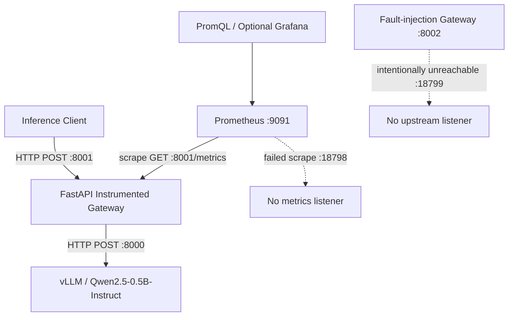

# Day 61 — Application Metrics for an AI Inference Gateway

**AI Infrastructure & ML Systems — 220-Day Learning Roadmap | Phase 4: Observability**

**Scope:** Local Linux lab, one FastAPI instrumented gateway, one vLLM inference backend, and one isolated Prometheus instance. The model used during this run was `Qwen/Qwen2.5-0.5B-Instruct`.

> Evidence standard: Values under **Observed** come from terminal output captured during the Day 61 session. Expectations, example queries, and any future work are labelled separately. This was a local educational experiment, not a production availability or load-capacity claim.

## 1. What this project demonstrates

- Implemented and exercised Prometheus `Counter`, `Gauge`, and classic `Histogram` metrics around an HTTP inference gateway.
- Exposed a `/metrics` endpoint and verified that an isolated Prometheus instance could scrape it.
- Used PromQL to query cumulative completed requests and a 5-minute request rate.
- Intentionally triggered an unreachable-upstream HTTP 502 response in a **separate** gateway process.
- Introduced a separate unreachable scrape target while keeping the primary metrics gateway healthy.
- Distinguished application failures from observability/scrape failures.

## 2. Architecture



**Traffic and telemetry are separate paths.** `up=1` proves only that Prometheus could scrape a target successfully, not that inference succeeded.

## 3. Directory layout

```text
day61-application-metrics/
├── app.py                        # Instrumented HTTP gateway
├── prometheus-day61.yml          # Isolated Prometheus scrape configuration
├── scripts/
│   ├── run_requests.sh           # Generate 10 non-streaming model requests
│   └── inspect_metrics.sh        # Inspect metrics and PromQL results
├── evidence/
│   └── measured-results.md       # Verified observations and evidence gaps
└── README.md
```

Note: This portfolio export contains a **reference copy** of `app.py` from the lab instructions. Reconcile it against your actual local implementation before committing, and preserve any changes you made on your machine.

## 4. Requirements and startup

- Linux with Python 3, `curl`, Docker, and an already working local vLLM server on `127.0.0.1:8000`.
- The deployed model was `Qwen/Qwen2.5-0.5B-Instruct`; use the exact ID reported by your own `/v1/models` endpoint.
- Tested architecture was single-process FastAPI gateway on `127.0.0.1:8001`; **not** a multiworker or distributed export configuration.

```bash
python3 -m venv .venv
source .venv/bin/activate
python -m pip install -r requirements.txt

# Verify upstream
curl -fsS http://127.0.0.1:8000/v1/models

# Terminal A
uvicorn app:app --host 127.0.0.1 --port 8001

# Terminal B
curl -fsS http://127.0.0.1:8001/health
curl -fsS http://127.0.0.1:8001/metrics | grep '^app_inference_'
```

### Prometheus on the Linux host network

The container uses host networking only for a local Linux lab, so `127.0.0.1:8001` resolves to the gateway on the host. In a normal Docker bridge network, `127.0.0.1` inside Prometheus refers to the **container itself**. Adjust your scrape address accordingly if your topology differs.

```bash
docker run -d \
  --name day61-prometheus \
  --network host \
  -v "$PWD/prometheus-day61.yml:/etc/prometheus/prometheus.yml:ro" \
  prom/prometheus:v3.16.0 \
  --config.file=/etc/prometheus/prometheus.yml \
  --web.listen-address=127.0.0.1:9091
```

If the container already exists, do **not** run it again; inspect/restart the existing container as appropriate.

### Configuration validation and reload

```bash
docker exec day61-prometheus promtool check config /etc/prometheus/prometheus.yml
docker kill --signal=HUP day61-prometheus
```

A successful signal command proves only that the signal was sent. Confirm that the intended active target set changed by inspecting `http://127.0.0.1:9091/targets` or `/api/v1/targets`. Prometheus does not apply invalid configuration on reload.

## 5. Metrics contract

| Metric | Type | Interpretation |
|---|---|---|
| `app_inference_requests_total{status_code="..."}` | Counter | Completed gateway requests grouped by response code; `rate()` yields requests/sec |
| `app_inference_inflight_requests` | Gauge | Number of gateway requests executing right now |
| `app_inference_request_duration_seconds` | Classic histogram | Gateway end-to-end duration, recorded in seconds, includes proxy + upstream latency |

The Gateway histogram exposes `_bucket{le="..."}`, `_sum`, and `_count`. Bucket series are **cumulative**. In this lab, the `status_code` label has low cardinality; never use unique request IDs or user identifiers as Prometheus labels.

### PromQL cookbook

```promql
# Did Prometheus successfully scrape the gateway?
up{job="day61-gateway"}

# Cumulative completed requests
sum(app_inference_requests_total)

# Mean completed requests per second over 5 minutes
sum(rate(app_inference_requests_total[5m]))

# Requests with HTTP 5xx per second
sum(rate(app_inference_requests_total{status_code=~"5.."}[5m]))

# Fraction of completed requests returning HTTP 5xx
sum(rate(app_inference_requests_total{status_code=~"5.."}[5m]))
/
sum(rate(app_inference_requests_total[5m]))

# Mean gateway request duration over 5 minutes, in seconds
sum(rate(app_inference_request_duration_seconds_sum[5m]))
/
sum(rate(app_inference_request_duration_seconds_count[5m]))

# Approximate p95 gateway request duration using classic buckets
histogram_quantile(
  0.95,
  sum by (le) (rate(app_inference_request_duration_seconds_bucket[5m]))
)
```

**Notes:** Rate queries need enough samples within the window. When the denominator is zero or the time series is absent, a ratio can be absent or non-finite. The p95 expression estimates a quantile from configured buckets, not exact per-request values.

## 6. Generate test traffic

```bash
bash scripts/run_requests.sh
bash scripts/inspect_metrics.sh
```

The ten-request script is sequential and is **not a capacity stress test**. It uses non-streaming chat completions and a model ID read from `/v1/models`.

## 7. Observed evidence

| Observation | Captured result | Interpretation |
|---|---:|---|
| First request | HTTP 200 | Healthy gateway forwarded one inference call |
| First gateway histogram `_sum` | 0.153894839 seconds | Internal duration for the first call (about 153.9 ms) |
| First gateway histogram `_count` | 1 | One duration observation |
| Subsequent inference requests | 10 × HTTP 200 | All subsequent sequential requests completed successfully |
| Subsequent client HTTP duration, mean | 0.1166952 seconds | Mean of 10 `curl` client durations, **not** measured gateway histogram mean |
| Subsequent client HTTP duration, range | 0.110220–0.127945 seconds | Min/max of those 10 client durations |
| Cumulative completed requests (PromQL) | 11 | Matches one initial plus ten later requests, no observed reset |
| `sum(rate(app_inference_requests_total[5m]))` | 0.0338983051 requests/s | Five-minute moving rate (~2.03/min), not burst throughput |
| Healthy gateway target `up` | 1 | Prometheus scrape succeeded |
| Unreachable target `up` | 0 | Deliberate scrape failure observed |
| Faulty gateway HTTP status | 502 | Deliberate upstream connection failure observed |
| Faulty gateway `/metrics` | HTTP 200 | Exporter remained accessible despite upstream failure |

**Remaining evidence gaps:** Faulty gateway `status_code="502"` Counter was not pasted before that process was stopped; and target-removal after a reload was not independently demonstrated. Both can be verified using the commands below.

For full evidence notes, see [`evidence/measured-results.md`](evidence/measured-results.md).

## 8. Repeatable break/fix runbooks

### Incident A: upstream is down, metrics still respond

In a separate terminal, launch a deliberately faulty **second** gateway:

```bash
VLLM_URL=http://127.0.0.1:18799/v1/chat/completions \
  uvicorn app:app --host 127.0.0.1 --port 8002
```

In another terminal, send one request to `http://127.0.0.1:8002/v1/chat/completions` (see the Day 61 training notes for the full JSON payload). **Before stopping port 8002**, capture:

```bash
curl -fsS http://127.0.0.1:8002/metrics | \
  grep -E '^app_inference_(requests_total|inflight_requests|request_duration_seconds_count)'
```

Expected for one failed request (not yet independently captured in the supplied terminal output):

```text
app_inference_requests_total{status_code="502"} 1.0
app_inference_inflight_requests 0.0
app_inference_request_duration_seconds_count 1.0
```

Why it matters: Count and time failures too; returning `up=1` says nothing about inference success.

### Incident B: Prometheus cannot scrape one target

Append the following job **temporarily** to `scrape_configs`:

```yaml
  - job_name: "day61-unreachable"
    scrape_interval: 5s
    static_configs:
      - targets: ["127.0.0.1:18798"]
```

After validation and a reload, verify:

```promql
up{job="day61-unreachable"} == 0
up{job="day61-gateway"} == 1
```

**Repair:** Remove the `day61-unreachable` scrape job, validate the YAML, reload Prometheus, and inspect the **active targets** page to ensure the broken job no longer appears. An old historical series can persist in storage even after the target is removed, so inspect active targets rather than assuming that a past metric sample disappearing is the only test.

### Decision tree

1. No `up` series? Confirm the job exists, configuration loaded and target was discovered.
2. `up=0`? Test address, namespace/network routing, process, port, and `/metrics` from Prometheus's environment.
3. `up=1`, errors increasing? Inspect HTTP status Counters, application logs and upstream health.
4. `up=1`, latency growing? Compare p50/p95 latency, concurrency, vLLM queueing and GPU telemetry.
5. Changes deployed? Check reset-aware `rate()` and record the exact time of the change.

## 9. Operational limitations and hardening backlog

- **No streaming proxy support:** the sample buffers an upstream response and is designed for `"stream": false` requests.
- **No authentication, TLS, rate limiting, input validation or secret handling** beyond the framework defaults: keep bound to loopback for the lab; do not expose publicly.
- **Single worker:** straightforward client metrics are per Python process. For multiple Gunicorn/Uvicorn workers, configure the Prometheus Python client's documented multiprocess mode and use an appropriate Gauge aggregation mode.
- **No automatic trace correlation or structured log propagation** yet. Add them during logging/tracing days.
- **Latency scope:** proxy e2e duration is not time-to-first-token, per-token latency or GPU-only time.
- **Sequential smoke test ≠ throughput benchmark.** Run controlled concurrency and load methodology before claiming scalability.
- **No uptime/SLO claim:** scrape status was observed at particular times, not over a long availability window.

## 10. Interview-ready project narrative

> I instrumented a FastAPI gateway in front of a local vLLM model with request Counters, an in-flight Gauge and request-latency histograms. I deployed an isolated Prometheus instance, verified the scrape target was up, and queried both cumulative requests and a reset-aware request rate. During a ten-request smoke test, all calls returned HTTP 200 and Prometheus recorded eleven cumulative requests including the earlier baseline call. I then isolated two failure modes: a deliberately unreachable upstream generated HTTP 502 while the gateway exporter stayed available, whereas an unreachable Prometheus target showed `up=0` while the healthy gateway stayed `up=1`. That helped me distinguish service correctness from metrics-collection health.

**Do not claim:** production deployment, sustained capacity, multi-GPU performance, or exact p95 numbers from the small sample.

## 11. Next improvements

- Day 62: time-to-first-token (TTFT), inter-token latency and end-to-end inference latency measurement.
- Day 63: controlled request rate, tokens/second, concurrency and load-test method.
- Days 64–70: GPU dashboard, centralized logs, tracing, alerting, SLIs/SLOs and observability capstone.
- Add screenshots of the Prometheus targets page, working PromQL results, and counter/gauge measurements after a 502 incident.

## References

- [Prometheus metric types](https://prometheus.io/docs/concepts/metric_types/)
- [Prometheus histograms and summaries](https://prometheus.io/docs/practices/histograms/)
- [Prometheus configuration and reloads](https://prometheus.io/docs/prometheus/latest/configuration/configuration/)
- [Prometheus metric naming and label cardinality](https://prometheus.io/docs/practices/naming/)
- [Prometheus Python client multiprocess mode](https://prometheus.github.io/client_python/multiprocess/)
