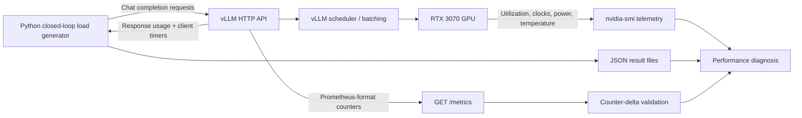
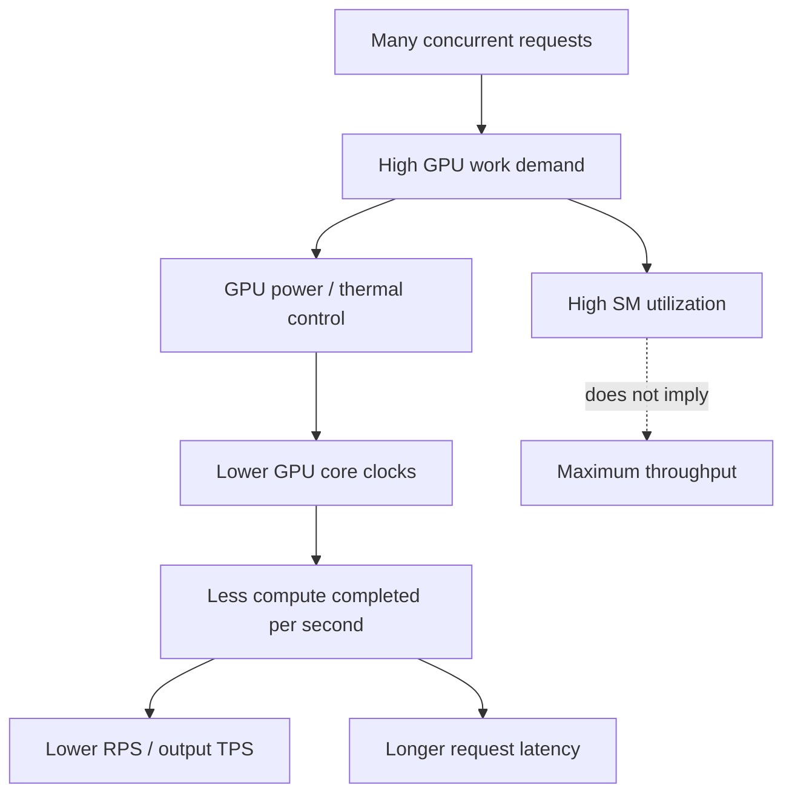

# Day 63 — Inference Throughput, Request Rate, and GPU Performance Diagnosis

> **AI Infrastructure & ML Systems — 220-Day Roadmap**  
> **Phase 4: Observability | Day 63 | November 17, 2026**  
> **Project:** Reproducible vLLM throughput benchmarking and cross-layer performance investigation

## Overview

This lab measures how **request concurrency** affects an LLM inference service's **completed requests per second (RPS)**, **generated output tokens per second (TPS)**, and **end-to-end latency**. It then correlates application performance with NVIDIA GPU telemetry to explain why high GPU utilization can coexist with poor throughput.

Experiments were performed on a local NVIDIA RTX 3070 Laptop GPU with a small Qwen model served using vLLM. The benchmark client and vLLM's native Prometheus-format `/metrics` endpoint agreed on completed-request and token totals in every reported test.

**Main result:** In a short 1,000-request trial, concurrency 32 achieved **173.85 RPS** and **5,544.71 output TPS**. A longer 5,000-request trial at the *same concurrency* achieved **133.74 RPS** with much higher p95 latency (**519 ms**, versus **201 ms**). Hardware telemetry showed a substantial GPU graphics-clock reduction under load, and NVIDIA diagnostics reported active software power-capping and thermal-slowdown indicators. Thus, the 173.85 RPS measurement **must not** be presented as sustained production capacity.

---

## Learning outcomes

- Distinguish **incoming request rate**, **completion throughput**, **token throughput**, and **goodput**.
- Explain how **concurrency, queueing, latency, and saturation** interact.
- Apply **Little's Law** to a stable inference workload: `average in-flight requests ≈ RPS × mean latency (seconds)`.
- Use vLLM counters, gauges, and latency histograms to monitor requests and token production.
- Write PromQL expressions using `rate()` and `increase()`.
- Benchmark concurrent requests; record RPS, output TPS, mean latency, and p95 latency.
- Correlate service-level performance with GPU utilization, clocks, temperature, and power constraints.

## Test environment

| Component | Configuration |
|---|---|
| GPU | NVIDIA GeForce RTX 3070 Laptop GPU, **8 GiB** VRAM |
| Inference engine | **vLLM** (API response fingerprint: `vllm-0.33.0-3419e5d7`) |
| Model | `Qwen/Qwen2.5-0.5B-Instruct` |
| Served maximum model length | **2,048 tokens** |
| Base API | `http://127.0.0.1:8000` |
| Inference endpoint | `/v1/chat/completions` |
| Native metrics endpoint | `/metrics` |
| Client | Python 3 standard library (`urllib.request`, `concurrent.futures`) |
| NVIDIA driver (captured during diagnosis) | `580.196.07` |
| CUDA version reported by `nvidia-smi` | `13.0` (driver-reported compatibility, not necessarily the installed toolkit version) |
| OS power profile during diagnosis | `balanced` |
| AC adapter state | `ACAD: 1` (external power detected) |

The tests reflect **this model, workload, device, driver, and operating conditions**. They should not be generalized to other models or GPUs.

## Architecture and measurement path



**What is actually measured:** The benchmark script reads the `/metrics` text endpoint directly before and after each run. The PromQL examples below demonstrate how a separately configured Prometheus server *could* calculate rolling rates; the recorded benchmark results **do not require or demonstrate an active Prometheus scraper**.

## Repository layout

```text
day63-throughput/
├── README.md
├── benchmark.py                       # Implemented locally during the lab
└── results/
    ├── concurrency_1_20261117_220951.json
    ├── concurrency_2_20261117_221705.json
    ├── concurrency_4_20261117_222044.json
    ├── concurrency_8_20261117_222356.json
    ├── concurrency_8_20261117_222854.json
    ├── concurrency_16_20261117_223259.json
    ├── concurrency_32_20261117_223815.json
    ├── concurrency_32_20261117_224408.json
    ├── concurrency_16_20261117_225138.json
    ├── gpu_c32.log                     # If saved locally
    ├── gpu_c32_long.log                # If saved locally
    └── gpu_c16_diagnostics.csv         # If saved locally
```


## Run the lab

### 1. Activate the existing environment and verify vLLM

```bash
activate-ai
cd ~/ai-infra/day63-throughput

curl -fsS http://127.0.0.1:8000/health
curl -fsS http://127.0.0.1:8000/v1/models | python3 -m json.tool
```

The existing server must be running and serving `Qwen/Qwen2.5-0.5B-Instruct`. Health HTTP `200` and a model listing establish basic service availability.

### 2. Inspect the available metric families

```bash
curl -fsS http://127.0.0.1:8000/metrics | \
  grep -E '^vllm:(request_success_total|prompt_tokens_total|generation_tokens_total|e2e_request_latency_seconds_count|num_requests_running|num_requests_waiting)(\{|[[:space:]])'
```

Metric names and labels depend on the serving version. In the observed environment, `vllm:request_success_total` had separate `finished_reason` label values (`stop`, `length`, `abort`, `error`, and `repetition`). Do **not** assume every completion-reason series corresponds to successful user-visible work.

### 3. Run controlled-concurrency benchmarks

The existing `benchmark.py` uses a **closed-loop** `ThreadPoolExecutor` to submit the next request when a worker becomes available. It sends the same prompt, `temperature=0`, and `max_tokens=48` in each request. It records client elapsed time, individual request latencies, prompt/output token usage, failures, finish reasons, and pre/post native metric-counter deltas.

```bash
# Short functional smoke tests
python benchmark.py --requests 20 --concurrency 1
python benchmark.py --requests 20 --concurrency 2
python benchmark.py --requests 20 --concurrency 4
python benchmark.py --requests 20 --concurrency 8

# Longer runs used in this lab
python benchmark.py --requests 1000 --concurrency 8
python benchmark.py --requests 1000 --concurrency 16
python benchmark.py --requests 1000 --concurrency 32
python benchmark.py --requests 5000 --concurrency 32
python benchmark.py --requests 5000 --concurrency 16
```

**Do not interpret the entire set as a controlled apples-to-apples concurrency sweep.** The experiments had different request counts, durations, and GPU clock/power conditions. The commands above document what was run, not a recommendation to repeat all tests without monitoring.

### 4. Collect GPU telemetry concurrently

Start monitoring in one terminal **before** starting a benchmark in another terminal.

```bash
mkdir -p results
nvidia-smi \
  --query-gpu=timestamp,temperature.gpu,power.draw,utilization.gpu,clocks.current.graphics,clocks.current.memory,memory.used \
  --format=csv -l 1 | tee results/gpu_c16_diagnostics.csv
```

Stop with `Ctrl+C` after the benchmark. For additional diagnostic snapshots:

```bash
nvidia-smi -q -d PERFORMANCE,CLOCK,POWER,TEMPERATURE
powerprofilesctl get
```

**Safety:** This lab observes the GPU; it does not raise power limits or force clock settings. If the system shows distress, errors, or unexpected temperatures, stop the load test.

---

## Results: short functional tests (20 requests per run)

| Concurrency | Requests | Duration (s) | RPS | Output TPS | Mean latency (ms) | p95 latency (ms) | Output tokens | Failures |
|---:|---:|---:|---:|---:|---:|---:|---:|---:|
| 1 | 20 | 2.534 | 7.89 | 268.34 | 127 | 131 | 680 | 0 |
| 2 | 20 | 1.393 | 14.36 | 488.13 | 139 | 149 | 680 | 0 |
| 4 | 20 | 0.661 | 30.24 | 964.79 | 132 | 145 | 638 | 0 |
| 8 | 20 | 0.448 | 44.68 | 1,405.26 | 150 | 160 | 629 | 0 |

**Interpretation:** More in-flight requests increased measured completion throughput. But with only 20 requests, especially at high concurrency, the benchmark runs were far too short for reliable sustained-capacity conclusions or tail-latency estimates.

## Results: longer workload trials

| Concurrency | Requests | Duration (s) | RPS | Output TPS | Mean latency (ms) | p95 latency (ms) | Output tokens | Failures |
|---:|---:|---:|---:|---:|---:|---:|---:|---:|
| 8 | 1,000 | 16.545 | 60.44 | 1,904.73 | 132 | 144 | 31,513 | 0 |
| 16 | 1,000 | 9.688 | 103.22 | 3,218.96 | 154 | 165 | 31,186 | 0 |
| 32 | 1,000 | 5.752 | **173.85** | **5,544.71** | 181 | 201 | 31,894 | 0 |
| 32 | 5,000 | 37.385 | **133.74** | **4,254.97** | 238 | 519 | 159,074 | 0 |
| 16 | 5,000 | 142.831 | **35.01** | **1,114.37** | 456 | 530 | 159,167 | 0 |

Each reported 1,000-request or 5,000-request run completed with zero client-reported failures and the same number of increments in the vLLM latency-observation count and `finished_reason="stop"` request counter. Prompt tokens were 41 per request in the longer runs; output lengths varied slightly.

### Throughput versus tail latency

- **C=8 → C=16, 1,000 requests:** RPS rose by approximately **70.8%** (60.44 → 103.22), while p95 latency increased from 144 to 165 ms.
- **C=16 → C=32, 1,000 requests:** RPS rose by approximately **68.4%** (103.22 → 173.85), while p95 increased from 165 to 201 ms.
- **C=32, 1,000 → 5,000 requests:** Measured RPS decreased by approximately **23.1%** (173.85 → 133.74), while p95 increased from 201 to 519 ms.
- **C=16, 1,000 → 5,000 requests:** Measured RPS decreased by approximately **66.1%** (103.22 → 35.01), while p95 increased from 165 to 530 ms.

These changes **correlate** with changes in GPU operating behavior. They are not a controlled estimate of the independent effect of concurrency because hardware state differed across experiments.

## GPU performance incident: busy GPU, reduced clocks

During the longer concurrency-32 and concurrency-16 runs, GPU monitoring showed **near-100% SM utilization** while graphics clocks dropped markedly. Representative, reported observations:

| Scenario | Graphics clock | SM utilization | Power / temperature | Observation |
|---|---|---|---|---|
| Earlier C=32 run, active phase | ~1,575–1,785 MHz | Mostly 90–100% | Not captured for that run | Initially high clocks |
| Longer C=32 run, later phase | ~315–570 MHz | ~98–100% | Not captured in the `dmon` sample | Markedly reduced clocks |
| Longer C=16 run, busy interval | Often ~255–540 MHz | Mostly ~97–100% | ~55 W, GPU temperature rose ~69→82°C | Sustained low clocks and poor throughput |

GPU diagnostics captured after the C=16 run showed:

```text
SW Power Cap             : Active
SW Thermal Slowdown      : Active
HW Thermal Slowdown      : Not Active
HW Power Brake Slowdown  : Not Active
Current Power Limit      : 55.00 W
Requested Power Limit    : 55.00 W
Default Power Limit      : 125.00 W
GPU Current Temp         : 82 C
GPU Target Temperature   : 87 C
GPU Slowdown Temp        : 98 C
```

A later idle snapshot showed the two software clock-limiting reasons as **Not Active**, while the 55 W configured limit remained. External power was detected (`ACAD: 1`), and the OS profile was `balanced`.

**Diagnosis:** The hardware was operating under power and thermal clock-management constraints during the extended test. Reduced GPU clocks are a strongly supported *contributor* to lower inference throughput despite high utilization. **The exact cause of the 55 W laptop power configuration and the relative contributions of thermal versus power policies were not established.** No power-limit or clock changes were made.

### Why this matters



The diagram is an interpretation of the observed pattern, not proof of a specific firmware, cooling, or power-policy fault.

---

## Measurement definitions and equations

**Client-observed throughput** (successful responses divided by wall-clock benchmark duration):

```text
RPS = successful_requests / elapsed_seconds
Output_TPS = sum(completion_tokens) / elapsed_seconds
Mean_latency = mean(per_request_elapsed_seconds)
p95_latency = nearest-rank 95th percentile of successful request elapsed times
```

For the C=16, 5,000-request run:

```text
RPS ≈ 5000 / 142.831 = 35.01 requests/s
Output TPS ≈ 159167 / 142.831 = 1114.37 tokens/s
```

**Little's Law** (under stable-state assumptions):

```text
Average in-flight requests ≈ completion_RPS × mean_latency_seconds
C=32, 5,000 requests: 133.74 × 0.238 ≈ 31.83 requests
C=16, 5,000 requests: 35.01 × 0.456 ≈ 15.96 requests
```

These values are close to configured client concurrency because workers maintained a mostly full closed-loop workload. They are only **approximate** for finite tests and rounded summaries.

**Goodput** requires a specified service-level criterion (for example, completed responses with p95 or individual latency within an actual SLO). No production SLO or goodput metric was established in this lab. A hypothetical 200 ms p95 limit mentioned during discussion is **not an adopted SLO**.

## PromQL recipes

The following queries are intended for a Prometheus server that is configured to scrape vLLM's metrics endpoint.

**Completed requests per second** (all exposed `finished_reason` values combined; filter reasons when necessary):

```promql
sum(rate(vllm:request_success_total[5m]))
```

**Normal-stop requests per second:**

```promql
sum(rate(vllm:request_success_total{finished_reason="stop"}[5m]))
```

**Estimated request completions over five minutes:**

```promql
sum(increase(vllm:request_success_total[5m]))
```

**Output tokens per second:**

```promql
sum(rate(vllm:generation_tokens_total[5m]))
```

**Prompt tokens per second:**

```promql
sum(rate(vllm:prompt_tokens_total[5m]))
```

**End-to-end latency observations per second:**

```promql
sum(rate(vllm:e2e_request_latency_seconds_count[5m]))
```

**Average end-to-end latency (seconds):**

```promql
sum(rate(vllm:e2e_request_latency_seconds_sum[5m]))
/
sum(rate(vllm:e2e_request_latency_seconds_count[5m]))
```

**Requests currently waiting and running:**

```promql
sum(vllm:num_requests_waiting)
sum(vllm:num_requests_running)
```

Use `rate()` on **counters** and aggregate *after* computing each series' rate, so counter resets can be handled independently. Use gauges directly for current running/waiting requests. Prometheus generally needs at least two samples in the range for `rate()`; an absent series is **not equivalent** to a measured zero.

## Reproducibility and limitations

1. **Closed-loop workload:** Fixed workers issue requests as earlier requests complete. It does **not** model a fixed exogenous arrival rate or independently reveal the open-loop overload point.
2. **Homogeneous prompt:** A single short prompt (41 prompt tokens in reported extended runs) with `max_tokens=48` is a useful baseline but not a representative production distribution of input/output lengths.
3. **Short and unequal trials:** The 20-request tests last less than three seconds; the 1,000-request trials are still brief. The 5,000-request runs differ in duration, and changing power/thermal state confounds concurrency comparisons.
4. **No repeated-run distribution:** Only one reported measurement per configuration/length; no confidence intervals or variance estimate for each configuration.
5. **GPU monitoring resolution:** `nvidia-smi` samples at about one second and can miss subsecond behavior. `mem=100%` is not the same as 100% VRAM allocation; `memory.used` reports allocated framebuffer memory.
6. **Latencies:** The script's mean/p95 use client elapsed times for successful, non-streaming requests. They are **not** first-token latency (TTFT) or per-output-token decode latency (TPOT).
7. **Counter semantics:** The vLLM request counter has finish-reason labels. The reported `stop` increments match completed requests in these runs, but HTTP arrival/error metrics would require separate web-server or gateway instrumentation.
8. **Power/thermal causality:** Diagnostics report clock-limiting conditions, but the laptop's underlying power policy and source of thermal control were not isolated. Avoid presenting speculative hardware fixes as confirmed.

For a stronger portfolio-grade capacity study, repeat fixed-duration experiments with consistent warmup, record run start/end timestamps, control for hardware power profile, sample GPU clocks/temperature concurrently, randomize or alternate concurrency order, and use comparable workloads. Keep a latency or goodput requirement explicit when recommending a configuration.

## Troubleshooting checklist

| Symptom | Check | Why |
|---|---|---|
| RPS drops, GPU shows ~100% utilization | Graphics/SM clocks, power cap, temperatures, throttle reasons | Utilization alone does not show how fast the GPU is executing |
| RPS plateaus and latency rises | Waiting requests, scheduler state, request lengths | Could indicate queueing or processing-capacity limits |
| Output TPS differs between otherwise similar tests | Generated-token counts and finish reasons | Work done may not be identical |
| Native counter stays unchanged | Confirm requests hit the expected vLLM process and metric labels | Wrong target/metric can hide traffic |
| PromQL `rate()` returns no result | Check scrape target, counter name, labels, sample window | No data differs from zero RPS |
| Test reports no failures but high latency | Examine latency percentiles and power/clock telemetry | Correct responses can still violate an SLO |

## Interview-ready explanation

> I built a Python client to benchmark vLLM serving Qwen2.5-0.5B-Instruct on an 8 GB RTX 3070 Laptop GPU. I measured completed RPS, output TPS, latency percentiles, and checked client totals against vLLM's Prometheus-format counters. Short-run throughput increased as concurrency rose, reaching 173.85 RPS at 32 concurrent requests. But a longer run at the same concurrency fell to 133.74 RPS, with p95 latency rising to 519 ms. GPU telemetry showed near-100% SM utilization while core clocks fell sharply, and diagnostics identified active software power and thermal clock limitations. The takeaway is that service capacity cannot be inferred from GPU utilization alone; hardware operating conditions and latency must be measured alongside throughput.

## Deliverables and status

- [x] Explain request rate, throughput, output TPS, latency, concurrency, and Little's Law.
- [x] Validate vLLM metric counters with real inference requests.
- [x] Build and execute a Python concurrency benchmark.
- [x] Record short-run and longer-run results, including failures and token totals.
- [x] Capture GPU clock, utilization, power, and temperature evidence.
- [x] Document a real throughput-degradation diagnosis and its limitations.
- [ ] Optional future enhancement: repeated fixed-duration trials and a synchronized Grafana throughput/latency/GPU dashboard.

## Related learning materials

- `Day63_Throughput_Request_Rate_Notes.pdf` — detailed instructional notes, diagrams, examples, and exercises (if included alongside this README).
- `Day63_Throughput_Request_Rate_Notes.tex` — editable LaTeX source (if included alongside this README).
- [vLLM documentation: monitoring metrics](https://docs.vllm.ai/en/latest/design/metrics/)
- [Prometheus documentation: query functions](https://prometheus.io/docs/prometheus/latest/querying/functions/)
- [NVIDIA System Management Interface documentation](https://docs.nvidia.com/deploy/nvidia-smi/)

**Day 63 complete.** The next roadmap topic is **Day 64 — GPU Utilization Dashboards**.