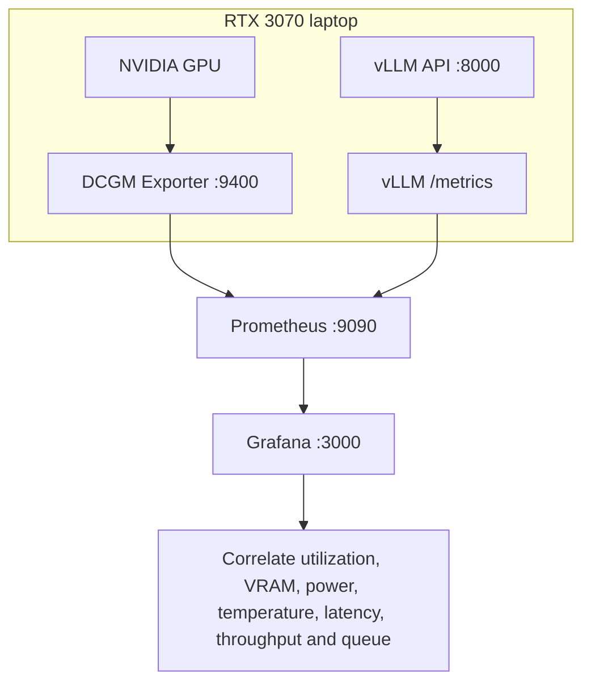
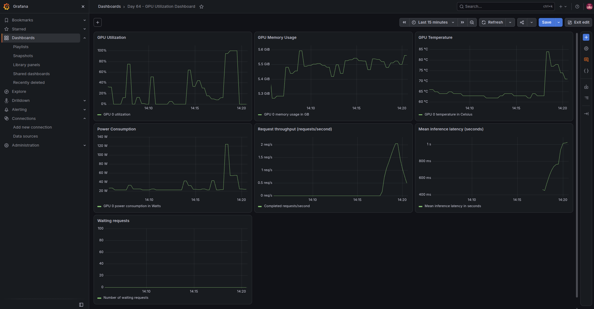
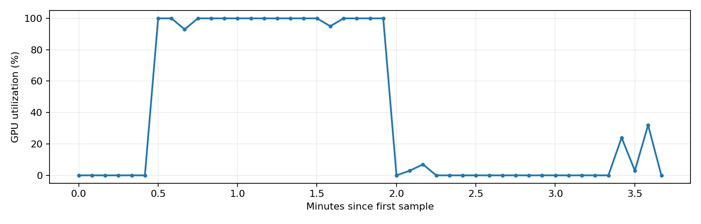

# Day 64 — GPU Utilization and Inference Observability

**Production-style monitoring lab | AI Infrastructure / ML Systems portfolio**  
**Completed:** November 18, 2026 | **Machine:** single RTX 3070 Laptop GPU (8 GiB)  
**Result:** 7-panel Grafana dashboard, healthy GPU + vLLM scrapes, controlled 2-worker load experiment, documented investigations.

> **Reproducibility / integrity:** The screenshots and benchmark summary come from the user's actual study session. The CSV was transcribed from the user-provided `nvidia-smi` log; the Grafana JSON is a **reconstructed template**, not a Grafana export. This repo does **not** claim hardware saturation, thermal throttling, or maximum possible throughput.

## 1. Why this matters

Inference performance cannot be assessed from GPU utilization alone. GPU activity, memory allocation, thermal/power state, throughput, latency, and queue depth are complementary signals. The goal is to build a coherent path from GPU telemetry to operational decisions.



## 2. Tested setup

| Layer | Actual configuration |
|---|---|
| GPU | NVIDIA GeForce RTX 3070 Laptop GPU, 8192 MiB |
| GPU driver | 580.196.07 |
| Model | `Qwen/Qwen2.5-0.5B-Instruct` |
| vLLM | 0.33.0, run from user's `ai-infra-venv`, port `127.0.0.1:8000` |
| Exporter | `nvcr.io/nvidia/k8s/dcgm-exporter:4.6.1-4.8.4`, port `127.0.0.1:9400` |
| Prometheus | Existing `day57-prometheus` host-network container, port 9090, 15-second scrapes |
| Grafana | Existing `day60-grafana` host-network container, port 3000 |
| Scrape jobs | `prometheus`, `vllm`, `dcgm-exporter` |
| Verified | `up=1` for all three jobs, actual DCGM fields exposed, dashboard populated |

**Hardware limitation:** DCGM reported no support for some `DCGM_FI_PROF_*` profiling metrics on this GeForce device. The core GPU utilization/VRAM/temperature/power metrics did work.

## 3. Dashboard evidence



The seven visible panels show GPU utilization, memory, temperature, power, completed request rate, rolling mean inference latency, and waiting requests. See `config/panel-queries.md` for exact PromQL. The two-minute mean latency and request-rate windows do not equal the benchmark's whole-run client latency statistics.

## 4. Actual load-test result

A 90-second **closed-loop** workload with two workers, 96-token generation cap, and the Qwen2.5-0.5B model reported:

| Statistic | Measured value |
|---|---:|
| Completed requests | 236 |
| Elapsed wall time | 90.62 s |
| Throughput | 2.60 completed requests/s |
| Generated output throughput | 250.01 tokens/s |
| Mean client-side latency | 0.7679 s |
| Client-side p95 latency | 1.0478 s |

At this tested concurrency level, `throughput x mean client latency = 2.60 x 0.7679 ≈ 2.00`, consistent with two closed-loop workers keeping requests in flight. This is a single measurement, **not** a throughput ceiling or open-loop performance characterization.

### GPU measurements around the workload

- GPU activity moved from initial 0% samples to repeated **93–100%** readings during the load period, then mostly back to 0% afterward.
- Occupied VRAM in the sampled log remained within **5608–5756 MiB** (~5.48–5.62 GiB), even while compute activity changed sharply.
- GPU temperature rose from about **63 C** to a sampled peak of **83 C**, then gradually declined after load.
- Sampled power reached **124.72 W** at high utilization, then fell to about **55 W** while utilization remained near 100% for multiple samples.
- Grafana showed waiting requests near zero in the displayed test window; no sustained queue buildup was visible at two workers.



**Interpretation:** GPU computation was highly active during the experiment; allocated memory changed comparatively little. The power reduction with high utilization motivates clock/performance-limit investigation, but does not prove thermal throttling. Queue depth near zero does not prove extra throughput capacity either. We need a concurrency sweep and error/latency analysis to find the service limit.

## 5. Reproduce the environment

This section assumes NVIDIA GPU Docker access and an installed vLLM environment. The actual lab **reused** existing Prometheus/Grafana services; do not replace the working scrape config unnecessarily.

```bash
# 1. Inspect existing monitoring services and local ports
docker ps --format 'table {{.Names}}\t{{.Status}}\t{{.Ports}}'
curl -fsS http://127.0.0.1:9090/-/ready
curl -fsS http://127.0.0.1:3000/api/health

# 2. Start exporter only if it is not already running
docker run -d --name day64-dcgm-exporter --gpus all \
  --restart unless-stopped -p 127.0.0.1:9400:9400 \
  nvcr.io/nvidia/k8s/dcgm-exporter:4.6.1-4.8.4

# 3. Run vLLM from the existing environment (separate terminal)
activate-ai
vllm serve Qwen/Qwen2.5-0.5B-Instruct \
  --host 127.0.0.1 --port 8000 --dtype auto \
  --max-model-len 2048 --gpu-memory-utilization 0.60
```

The two inference monitoring endpoints are:

- GPU: `curl -fsS http://127.0.0.1:9400/metrics`
- Inference: `curl -fsS http://127.0.0.1:8000/metrics`

Prometheus already had `dcgm-exporter` and `vllm` jobs (`config/prometheus-existing-jobs.yml` shows the relevant subset). Validate them:

```bash
curl -fsSG \
  --data-urlencode 'query=up{job=~"prometheus|dcgm-exporter|vllm"}' \
  http://127.0.0.1:9090/api/v1/query | python3 -m json.tool
```

Grafana at `http://127.0.0.1:3000` can use the existing Prometheus data source at `http://127.0.0.1:9090` because the user's containers run with `network=host`. For other Docker networking modes, these `localhost` URLs may be wrong.

**Dashboard replication:** build the panels using `config/panel-queries.md`, or import `config/grafana-dashboard-TEMPLATE.json` and select the Prometheus data source. This JSON is only an approximation of the hand-built dashboard. For exact settings and panel history, export your original JSON from Grafana.

## 6. Repeat the benchmark

```bash
# Terminal 1: log live GPU telemetry
./gpu_sample.sh evidence/gpu-new-run.csv

# Terminal 2: controlled model load (requires active model API)
python day64_load.py --workers 2 --duration 90 --max-tokens 96 \
  | tee evidence/load-test-new.txt
```

Check temperature/power while testing on a laptop. Stop if stability or thermal behavior is concerning. The script reports successful requests, failed requests, throughput, and client-side response latency. It is not a substitute for a production-grade workload generator. For a capacity curve, use at least 1, 2, 4, and 8 concurrency (only if safe), identical prompt/token distributions, repeated runs, warmups, and an explicit p95 SLO; capture per-run error counts, queue depth, clock state, and power behavior.

## 7. Diagnostic patterns and decisions

| Evidence | Hypothesis / next step |
|---|---|
| GPU busy, queue zero, latency acceptable | Productive activity; saturation not proven |
| Throughput flat, p95 and queue increasing under more load | Possible service-capacity limit; examine GPU, scheduler, CPU, memory |
| High VRAM allocation, low GPU activity | Often loaded weights/reserved KV cache; test for memory pressure separately |
| GPU activity high, power declines | Examine clocks, thermal and power/performance limit reasons while the event occurs |
| `up=1` but Grafana panel empty | Verify metric name, labels, PromQL, scrape cadence, data source, and time range |

Operational incident workflow and specific commands are in [RUNBOOK.md](RUNBOOK.md).

## 8. Key findings and engineering limitations

**Demonstrated:** functional GPU exporter, Prometheus scrape connectivity, Grafana GPU/application dashboard, real two-worker vLLM benchmark, repeatable telemetry collection, evidence-based diagnosis.

**Not demonstrated:** throughput capacity at higher concurrency, service-wide SLO compliance, causal thermal throttling, power optimization, multi-GPU behavior, stable performance under long-running production traffic, or production alerting.

**Suggested next steps:** run a safe concurrency sweep, record SM clock/performance limit reasons during load, build p95/p99 server-latency panels, export the *actual* Grafana JSON, and create alerts during Days 68–70.

## 9. Files in this portfolio

```text
Day64_GPU_Observability_Portfolio/
├── README.md                          ← engineering narrative + methodology
├── RUNBOOK.md                         ← break/fix troubleshooting
├── day64_load.py                      ← configurable closed-loop load generator
├── gpu_sample.sh                      ← 5-second nvidia-smi capture
├── config/
│   ├── prometheus-existing-jobs.yml  ← actual job names (reference snippet)
│   ├── panel-queries.md              ← panel PromQL
│   └── grafana-dashboard-TEMPLATE.json ← reconstructed import template
├── evidence/
│   ├── load-test.txt                 ← reported benchmark output
│   ├── gpu-samples.csv               ← transcribed timestamped GPU trace
│   ├── experiment-metadata.md       ← provenance/limitations
│   └── grafana-dashboard-*.png       ← supplied screenshots
├── figures/                           ← charts rendered from the trace
└── notes/
    ├── Day64_GPU_Dashboard_Notes.tex ← editable LaTeX teaching notes
    └── Day64_GPU_Dashboard_Notes.pdf ← rendered instructional PDF
```

## 10. Technical references

- [NVIDIA DCGM Exporter metrics documentation](https://docs.nvidia.com/datacenter/dcgm/latest/reference/dcgm-exporter-metrics.html)
- [vLLM production metrics](https://docs.vllm.ai/en/latest/usage/metrics/)
- [Prometheus configuration](https://prometheus.io/docs/prometheus/latest/configuration/configuration/)

**Interview summary:** "I instrumented a single-GPU vLLM serving stack with DCGM Exporter and Prometheus, built a seven-panel Grafana dashboard, ran a measured two-worker inference load, and correlated GPU utilization, VRAM occupancy, thermal/power trends, throughput, latency and queue depth. I identified a power-change anomaly for investigation, without mislabeling it as thermal throttling or claiming a maximum throughput capacity."
