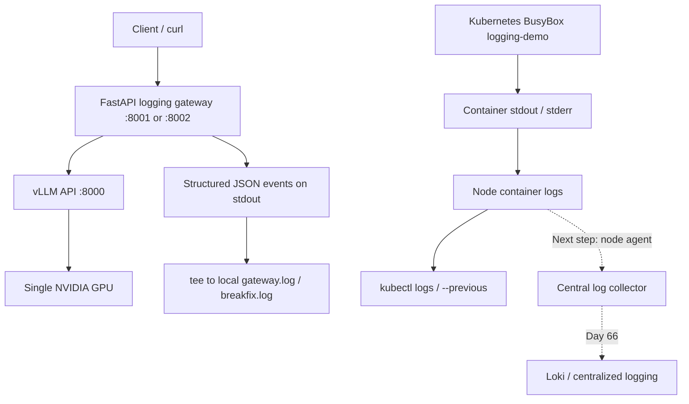

# Day 65 — Logging Architecture for an AI Inference Gateway

**Track:** AI Infrastructure & ML Systems · Phase 4: Observability · Day 65/220  
**Environment:** Ubuntu laptop, single NVIDIA GPU, local vLLM service (Qwen/Qwen2.5-0.5B-Instruct), FastAPI gateway, Kubernetes `gpu-lab` cluster  
**Status:** Gateway logging, invalid-model error investigation, Kubernetes container-restart analysis, and backend break/fix recovery tested successfully. Final recovery **log-file JSON validation remains unverified**.

## Why this project matters

Reliable inference requires more than a green health check. This lab shows how structured logs, stable request IDs, Kubernetes container logs, and incident evidence help distinguish invalid user requests from upstream connectivity failures.

## Architecture



**Key limitations:** The current gateway runs locally, not as a Kubernetes Deployment. The Kubernetes demonstration is a separate BusyBox Pod, not the vLLM gateway. Local `tee` files are **not centralized durable logging**. The gateway assigns request IDs but does **not yet forward them to vLLM**.

## Lab components

- `logging_gateway.py`: FastAPI JSON logging gateway, fixed upstream URL (`127.0.0.1:8000`).
- `logging_gateway_breakfix.py`: Same gateway, but reads `VLLM_URL` from the environment for safe fault injection.
- `kubernetes-logging-demo.yaml`: BusyBox Pod that intentionally exits once, then writes heartbeats. Its `emptyDir` marker survives the container restart but not a new Pod.
- `INCIDENT_REPORT.md`: Actual observed fault, evidence, remediation, recovery, and improvements.
- `evidence/observations.md`: Measurements and caveats transcribed from completed terminal exercises.

These source files are **reference reproductions** of the exercises, not copies downloaded from the user's workstation. Compare with local versions before committing.

## Prerequisites

- Python 3 with `venv`; packages in `requirements.txt`.
- A running OpenAI-compatible vLLM API on `http://127.0.0.1:8000` serving `Qwen/Qwen2.5-0.5B-Instruct` for real inference tests.
- `kubectl` access to a disposable test Kubernetes cluster for the container lifecycle lab.

## Reproduce the local logging gateway

```bash
cd day65_logging_portfolio
python3 -m venv .venv
source .venv/bin/activate
python -m pip install -r requirements.txt

# Terminal A: do not run multiple gateways on the same port.
python -m uvicorn logging_gateway:app \
  --host 127.0.0.1 --port 8001 \
  --no-access-log --log-level warning 2>&1 | tee gateway.log
```

From Terminal B:

```bash
curl -i http://127.0.0.1:8001/health
curl -i http://127.0.0.1:8001/simulate-error

curl -sS -o /tmp/day65-response.json \
  -w 'http=%{http_code} total_s=%{time_total}\n' \
  http://127.0.0.1:8001/v1/chat/completions \
  -H 'Content-Type: application/json' \
  --data-binary @<(printf '%s' '{"model":"Qwen/Qwen2.5-0.5B-Instruct","messages":[{"role":"user","content":"Reply with one word: ready"}],"max_tokens":16,"temperature":0}')

python3 -m json.tool /tmp/day65-response.json
tail -n 3 gateway.log
```

The command above uses Bash process substitution (`<(...)`). It avoids placing prompt text in application logs; the shell command itself remains visible in shell history. Keep real secrets out of commands and log output.

## Reproduce the Kubernetes restart lab

```bash
kubectl apply -f kubernetes-logging-demo.yaml
kubectl get pods -n ai-infra-logging -w
kubectl logs logging-demo -n ai-infra-logging --tail=5 --timestamps
kubectl logs logging-demo -n ai-infra-logging --previous --timestamps
kubectl describe pod logging-demo -n ai-infra-logging
```

Expected: initial intentional `exit 1`, then `Running` with restart count 1, current INFO heartbeats, and the prior ERROR crash record via `--previous`. The namespace is created by the YAML manifest. Remove only this lab when finished:

```bash
kubectl delete namespace ai-infra-logging
```

## Reproduce the backend connectivity incident safely

Do **not** stop a working vLLM process. Launch a **separate** gateway on port 8002 and intentionally target an unused port:

```bash
VLLM_URL=http://127.0.0.1:8999/v1/chat/completions \
python -m uvicorn logging_gateway_breakfix:app \
  --host 127.0.0.1 --port 8002 \
  --no-access-log --log-level warning 2>&1 | tee breakfix.log
```

Send an inference request using the earlier curl command with port `8002`. The expected transport-failure evidence is `ConnectError` and an HTTP 502. Stop **only this** gateway with Ctrl+C, then restart it with the correct `VLLM_URL` and append evidence:

```bash
VLLM_URL=http://127.0.0.1:8000/v1/chat/completions \
python -m uvicorn logging_gateway_breakfix:app \
  --host 127.0.0.1 --port 8002 \
  --no-access-log --log-level warning 2>&1 | tee -a breakfix.log
```

To verify log integrity following recovery:

```bash
tail -n 1 breakfix.log | python3 -m json.tool
```

**Observed outcome:** The recovered gateway returned HTTP 200 and model text `Ready.`; the printed copy of the final log record was truncated, so JSON integrity of that record should be checked before declaring the logging pipeline fully validated.

## Operations takeaways

1. Distinguish **log severity** (e.g., ERROR) from the `stdout` / `stderr` output stream.
2. Use `request_id` to correlate gateway events, but propagate trace/request context across services to achieve true end-to-end correlation.
3. Use `kubectl logs --previous` after container restarts while those local records remain available; this is not a permanent archive.
4. Combine HTTP status, exception class, request metadata, Kubernetes state, and direct dependency checks before naming a root cause.
5. Prefer least-privilege access, controlled retention, and redaction; never log raw prompts, credentials, or tokens by default.
6. For production, add readiness checks, bounded concurrency/timeouts, log shipping/rotation, and alerting. These enhancements are **not yet implemented** in this project.

## Interview story

**Situation:** A healthy FastAPI inference gateway returned 502 for a test request, even though the local vLLM health endpoint returned 200.  
**Task:** Determine whether the failure was in the model server, GPU infrastructure, or service-to-service configuration.  
**Action:** Correlated `upstream_connection_failed` / `http_request_completed` events using a shared request ID; observed `ConnectError`; compared gateway configuration to vLLM's actual listening port; corrected `VLLM_URL`.  
**Result:** The same gateway route recovered to HTTP 200 and returned `Ready.`. Client time was 29.794 ms for the rejected request and 70.697 ms for the successful one. These one-off timings are **not benchmarks**.

## Next step

Day 66: ship Kubernetes node-level logs to Loki using a collector; query across instances from Grafana and document retention / label-cardinality tradeoffs.
