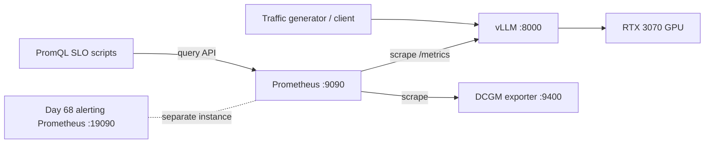

# Day 69 — Service-Level Objectives for AI Inference

Implemented and validated request-success and latency SLIs, error budgets, and burn-rate calculations for a local GPU-backed vLLM service using Prometheus. A deliberately stricter TTFT threshold validates violation detection without disrupting the server.

## Architecture



## Environment

- NVIDIA GeForce RTX 3070 Laptop GPU, 8 GiB; driver 580.196.07.
- Model: `Qwen/Qwen2.5-0.5B-Instruct`, maximum model length 2048.
- vLLM: `127.0.0.1:8000`; inference route `/v1/chat/completions`.
- Day 57 Prometheus: `127.0.0.1:9090`, configured retention 7 days.
- Day 68 alerting Prometheus: `127.0.0.1:19090`, lifecycle API enabled. Separate instance; scrape relationship not verified here.
- DCGM exporter: `127.0.0.1:9400`. Grafana was running but dashboard creation was intentionally skipped.

## Experimental objectives

| SLI | Threshold | Target | Error budget |
|---|---|---:|---:|
| HTTP success proxy | 2xx among 2xx and 5xx chat POST responses | 99.9% | 0.1% |
| Engine TTFT | <= 0.5 s | 99% | 1% |
| Engine E2E latency | <= 2.5 s | 95% | 5% |

The lab evaluates a 30-minute window; rolling 30-day production objectives are proposals only. The 2.5 s E2E threshold matches an exposed classic histogram bucket; 3 s is not available. Latency denominators are recorded engine observations, not all client attempts.

## Reproduction

From `~/ai-infra/day69-slo`, with the existing services running:

```bash
curl -fsS http://127.0.0.1:8000/health
curl -fsS http://127.0.0.1:9090/-/ready
curl -fsS http://127.0.0.1:8000/metrics > metrics-baseline.txt
./generate-traffic.sh 30 | tee baseline-traffic.log
curl -fsS http://127.0.0.1:8000/metrics > metrics-after-traffic.txt
# After the initial HTTP status series has been scraped:
./generate-traffic.sh 30 | tee baseline-traffic-2.log
# Allow another successful scrape before evaluating:
./check-slos.sh 30m | tee slo-baseline.log
./test-slo-violation.sh 30m | tee slo-violation.log
```

The traffic generator makes sequential, nonstreaming requests with `max_tokens=32` and temperature 0, approximately one second apart. Verify the model name and metric labels in your deployment before running. If historical traffic has aged out of the range window, generate fresh traffic.

## PromQL examples

HTTP availability proxy (percent):

```promql
100 * sum(increase(http_requests_total{job="vllm",handler="/v1/chat/completions",method="POST",status="2xx"}[30m]))
/ sum(increase(http_requests_total{job="vllm",handler="/v1/chat/completions",method="POST",status=~"2xx|5xx"}[30m]))
```

TTFT compliance (percent):

```promql
100 * sum(increase(vllm:time_to_first_token_seconds_bucket{job="vllm",le="0.5"}[30m]))
/ sum(increase(vllm:time_to_first_token_seconds_count{job="vllm"}[30m]))
```

E2E compliance uses the same pattern with `vllm:e2e_request_latency_seconds_bucket{job="vllm",le="2.5"}` and its matching `_count`. Mean latency in milliseconds is `1000 * sum(increase(<metric>_sum[30m])) / sum(increase(<metric>_count[30m]))` (substitute metric and matching labels).

TTFT burn rate (5-minute window, 99% target):

```promql
(1 - sum(rate(vllm:time_to_first_token_seconds_bucket{job="vllm",le="0.5"}[5m]))
/ sum(rate(vllm:time_to_first_token_seconds_count{job="vllm"}[5m]))) / 0.01
```

Budget consumed (%) = `100 * (1 - compliance_fraction) / (1 - slo_fraction)` over the SLO evaluation window. Remaining (%) = `100 - consumed`. Avoid treating zero traffic or absent metrics as perfect compliance.

## Results — November 23, 2026

| Measurement | Initial raw snapshot (30 requests) | Subsequent 30m PromQL evaluation |
|---|---:|---:|
| HTTP success proxy | 100% | 100% (floating-point rounding) |
| TTFT compliance | 100% | 100% |
| E2E compliance | 100% | 100% |
| Average engine TTFT | 8.0733 ms | 7.7646 ms |
| Average engine E2E | 128.6122 ms | 127.5654 ms |
| TTFT / E2E burn | 0x | 0x |

Both traffic batches returned 30/30 HTTP 200 responses (60/60 total). Initial engine completion reasons: 30 `length`, zero `stop` and `abort`. First client request took 1.593647 s; subsequent first-batch requests were approximately 0.133–0.160 s. Warmup is a plausible hypothesis, not a confirmed root cause. The 30m `increase()` estimates were approximately 56.43 TTFT and E2E observations, not exact raw event counts.

### Controlled objective violation

Keep the server unchanged; evaluate the existing TTFT histogram at `le="0.005"` rather than `le="0.5"` while retaining the 99% compliance target.

| Metric | Observed |
|---|---:|
| Estimated observations | 60.4373 |
| Compliance within 5 ms | 0% |
| Bad events | 100% |
| Burn rate | 100x |
| Window budget consumed | 10,000% |
| Window budget remaining | -9,900% |

This verifies the arithmetic and detection of a violated objective, not an outage, real performance regression, firing alert or Alertmanager delivery test. Under constant traffic, a full fixed 30-day budget would be exhausted in 7.2 hours at a sustained 100x burn rate; this is a conditional projection, not a measured event.

## Artifacts from the lab

```text
day69-slo/
├── generate-traffic.sh
├── check-slos.sh
├── test-slo-violation.sh
├── metrics-baseline.txt
├── metrics-after-traffic.txt
├── baseline-traffic.log
├── baseline-traffic-2.log
├── slo-baseline.log
└── slo-violation.log
```

## Limitations and next steps

- Server-side 2xx/5xx success omits failures before the server, client timeouts, excluded 4xx (including potential overload-related 429), and incomplete streams that already returned 2xx. Introduce a client-facing eligible-event counter and independent probes.
- Histogram ratios cover recorded observations; failed requests without observations may be omitted. A joint success/latency SLI requires event-level joint instrumentation, not multiplication of separate percentages.
- `increase()` extrapolates and accounts for resets; newly appearing series may miss their first increments. Raw snapshot differences are exact only with no reset and comparable series.
- A sample of 60 sequential requests is not evidence of a sustained 99.9% SLO or maximum serving capacity. Use representative concurrent load and workload classes.
- Seven-day retention cannot establish a complete rolling 30-day objective; configure sufficient retention or long-term storage and verify coverage.
- Day 70: integrate monitoring, independent probes, alert rules, logs/traces and reproducible incident evidence. Grafana and live notification tests were intentionally not performed on Day 69.

## References

- [Google SRE Workbook — Implementing SLOs](https://sre.google/workbook/implementing-slos/)
- [Google SRE Workbook — Alerting on SLOs](https://sre.google/workbook/alerting-on-slos/)
- [Prometheus — Histograms and summaries](https://prometheus.io/docs/practices/histograms/)
- [Prometheus — Query functions](https://prometheus.io/docs/prometheus/latest/querying/functions/)
- [vLLM documentation](https://docs.vllm.ai/)
